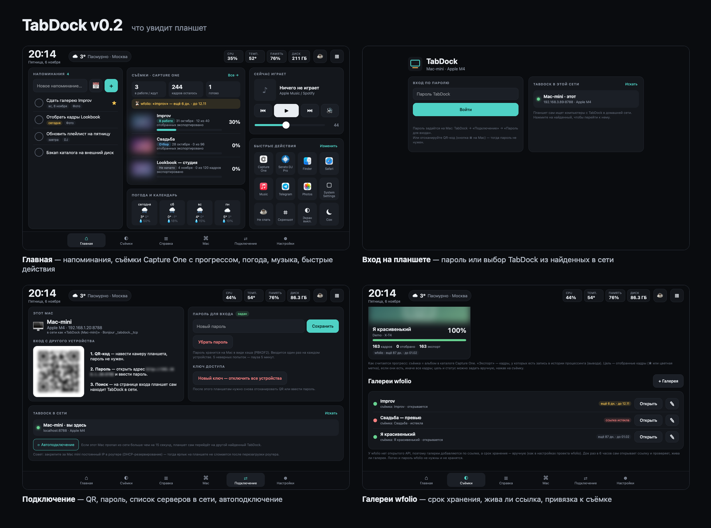
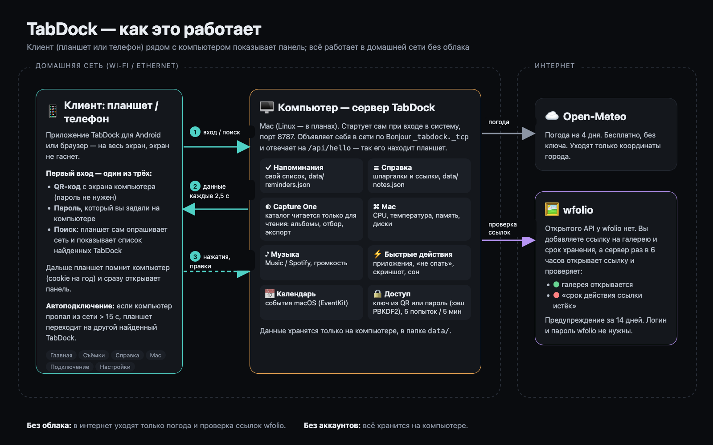
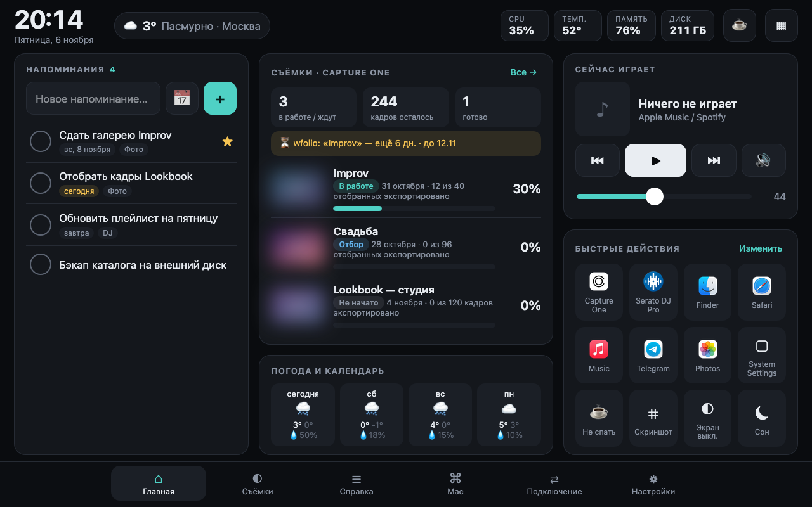
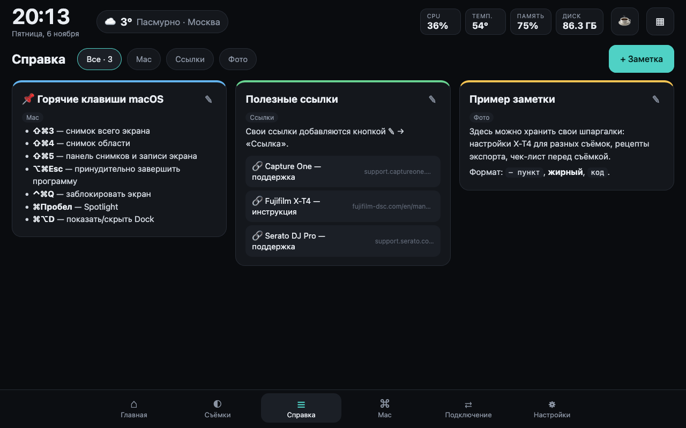
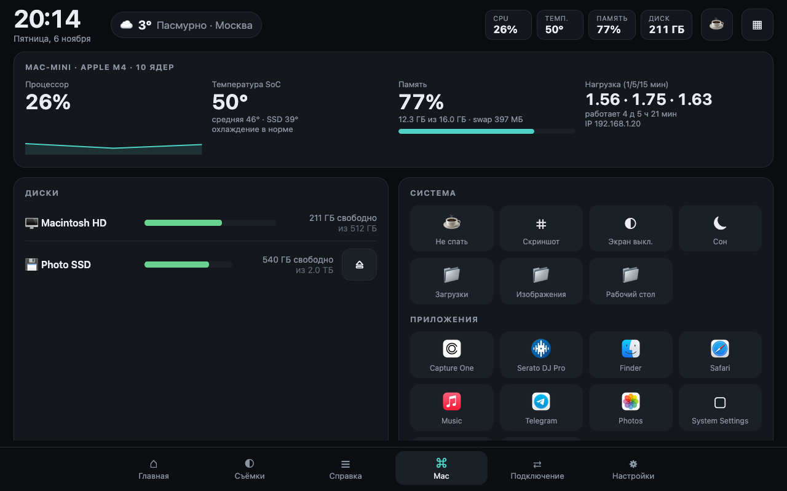
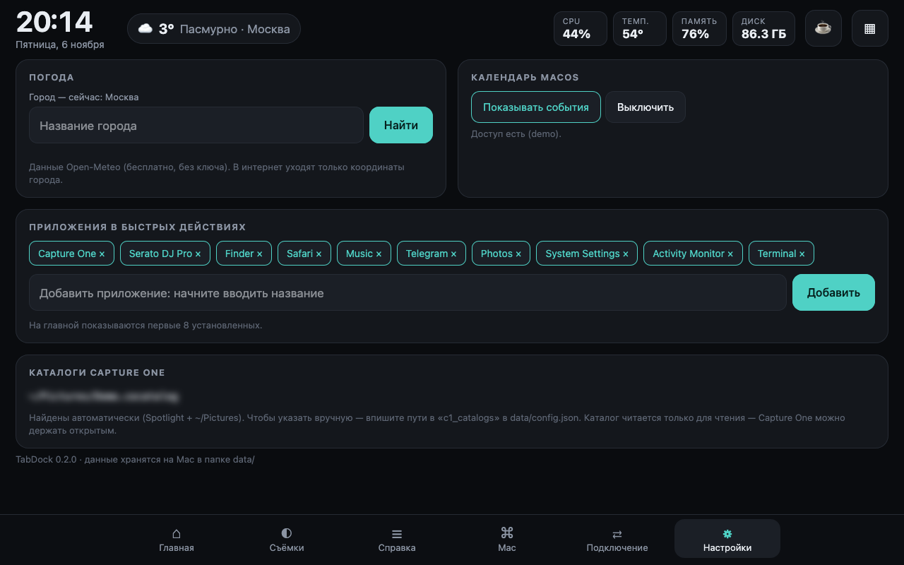
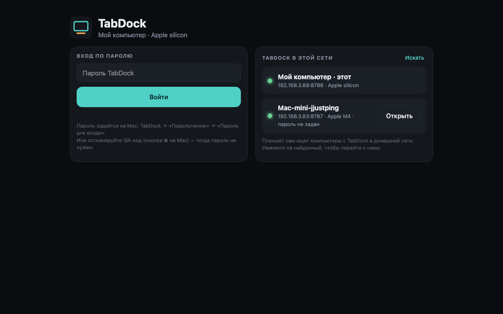
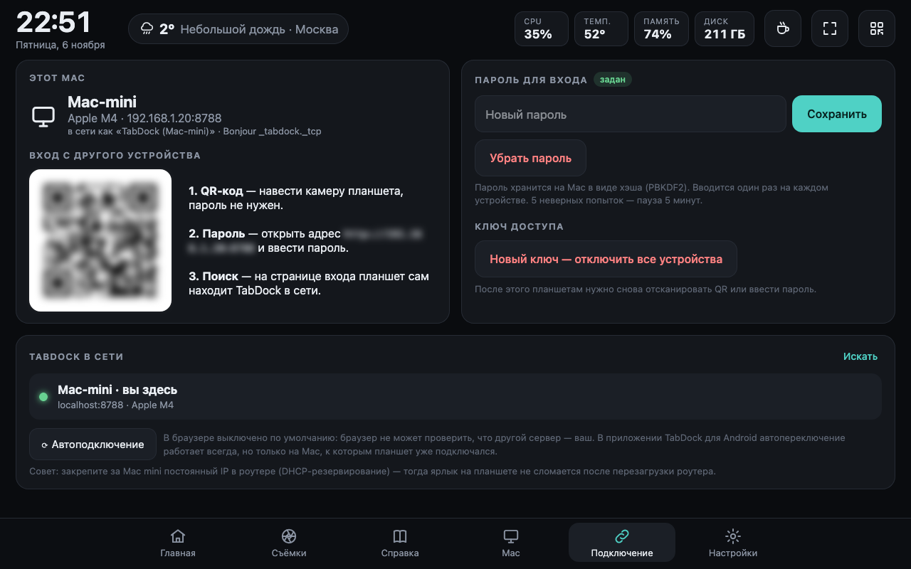
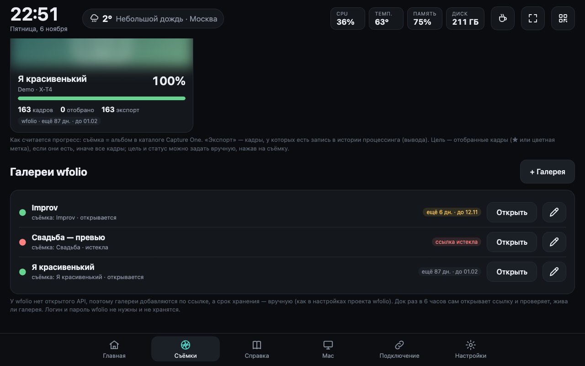
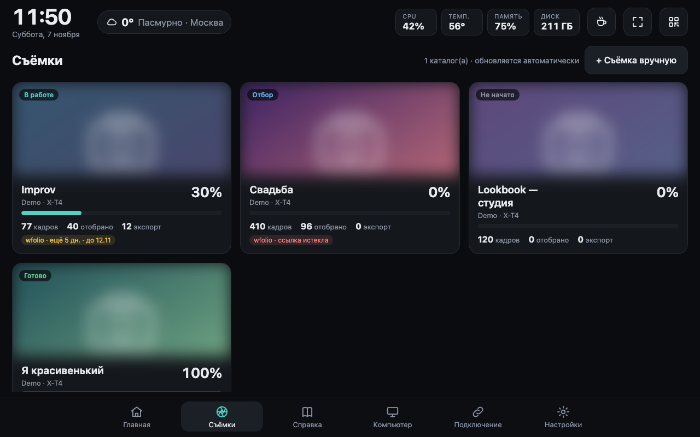

# TabDock

[Русский](#русский) · [English](#english)



---

## Русский

**TabDock превращает планшет, который давно лежит без дела, в полезный док для работы на Mac.**
Поставьте старый Android-планшет (или iPad) рядом с компьютером, и он станет вторым сенсорным экраном с тем,
что обычно приходится искать по окнам: напоминания, прогресс обработки съёмок в Capture One, шпаргалки,
состояние Mac, музыка и быстрые действия. Панель открывается и в браузере на самом Mac.

Всё работает локально в домашней сети: без облака, аккаунтов и подписок (интернет нужен только для погоды
и проверки ссылок wfolio). Сделано под Mac mini M4 + Honor Pad 9, но подойдёт любой Mac с macOS 13+ и любой
планшет с современным браузером.

### Что умеет (v0.3)

| Блок | Что делает |
|---|---|
| **Напоминания** | Свой список: добавить одной строкой, отметить касанием, срок (сегодня / завтра / дата), ★ важное, теги. Выполненные прячутся. |
| **Съёмки · Capture One** | Читает каталог(и) Capture One **только для чтения**. Каждая съёмка — это альбом: обложка, сколько кадров, сколько отобрано (★ или цветная метка), сколько экспортировано (по истории процессинга), прогресс и статус. Статус, цель (сколько кадров сдать), срок, клиента и заметку можно задать вручную. Можно добавить съёмку вручную, если её нет в каталоге. Кнопка «Открыть в Capture One». |
| **Справка** | Карточки-шпаргалки с простым форматированием (`- список`, `**жирный**`, `` `код` ``), ссылками, цветом, разделами и закреплением. Редактируются с планшета. |
| **Mac** | Загрузка CPU с графиком, температура SoC и SSD (без sudo), память и swap, все диски (внешние можно извлечь), аптайм, IP. |
| **Музыка** | Apple Music / Spotify: что играет, обложка, пауза / назад / вперёд, громкость и mute. |
| **Быстрые действия** | Запуск выбранных приложений (иконки берутся из самих приложений), «Не спать» (caffeinate), скриншот на Рабочий стол, выключить экран, сон (двойное касание для подтверждения), открыть папки. |
| **Погода и календарь** | Погода Open-Meteo (бесплатно, без ключа) на 4 дня; события Календаря macOS на сегодня и завтра. |
| **Подключение** (v0.2) | Отдельная вкладка: вход по QR **или по паролю**, планшет сам ищет TabDock в домашней сети и показывает список, автопереключение, если текущий Mac пропал. |
| **Галереи wfolio** (v0.2) | Ссылки на клиентские галереи со сроком хранения: сколько дней осталось, предупреждение за 14 дней, раз в 6 часов док проверяет, открывается ли ссылка. Привязка к съёмке Capture One. |

### Как это работает


*Планшет и Mac в домашней сети; в интернет уходят только погода и проверка ссылок wfolio.*

### Экраны


*Главная: напоминания, съёмки Capture One с прогрессом, погода и календарь, музыка, быстрые действия.*


*Справка: свои шпаргалки и ссылки, разделы, цвета, закрепление.*


*Mac: процессор, температура, память, диски (внешние можно извлечь), системные действия и приложения.*


*Настройки: город для погоды, календарь, приложения в быстрых действиях, каталоги Capture One.*

(Все экраны сняты в демо-режиме: съёмки и обложки выдуманные.)

### Установка на Mac mini

```bash
git clone … ~/tabdock     # или скопируйте папку; не кладите её в Документы/Рабочий стол/Загрузки
cd ~/tabdock
./install.sh
```

`install.sh` создаёт `.venv`, ставит единственную зависимость (`qrcode`), собирает помощник календаря
(`bin/dock-calendar`, нужен `swiftc` из Command Line Tools), регистрирует LaunchAgent
`~/Library/LaunchAgents/com.jjustping.tabdock.plist` (старт при входе в macOS, перезапуск при падении)
и открывает панель в браузере.

```bash
./install.sh --status      # запущен ли и ссылка для планшета
./install.sh --port 9000   # другой порт
./install.sh --uninstall   # убрать автозапуск (данные в data/ остаются)
```

Ручной запуск без автозапуска: `.venv/bin/python server.py` → http://localhost:8787

### Приложение для Android (v0.3)

Лучше, чем вкладка Chrome: `android/` — маленькое приложение (28 КБ) с WebView, которое
* **само находит Mac** через Bonjour (`_tabdock._tcp`) и опросом сети — браузер так не умеет;
* открывается на весь экран, **не даёт экрану гаснуть**, держит альбомную ориентацию;
* помнит последний Mac и вход; если Mac выключили или перезагрузили — показывает «Жду …» и **сам
  открывает панель**, как только Mac снова в сети; если пропал совсем — переходит на другой найденный TabDock;
* ссылки наружу (галереи wfolio и т.п.) открывает в обычном браузере.

Сборка без Android Studio и Gradle (нужны Android SDK и JDK 17, `brew install openjdk@17`):

```bash
./android/build.sh                       # → android/build/TabDock.apk
adb install -r android/build/TabDock.apk
```

Ключ подписи создаётся при первой сборке в `~/.android/tabdock-release.keystore` — сохраните его, иначе
обновить приложение поверх не получится (только удалить и поставить заново). Первый вход в приложении —
паролем, или передать ключ из QR: `adb shell am start -n com.jjustping.tabdock/.MainActivity -d "<ссылка из QR>"`.

### Подключение планшета


*Вход на планшете: пароль слева, справа TabDock, найденные в сети автоматически.*


*Вкладка «Подключение»: QR-код, пароль, ключ доступа, список Mac в сети и автоподключение.*

1. Планшет и Mac в одной сети.
2. На Mac нажмите ▦ (вверху справа) — появится QR-код.
3. Отсканируйте камерой планшета и откройте ссылку в Chrome. Планшет запомнится (cookie на год).
4. В Chrome: меню ⋮ → «Добавить на главный экран» — панель откроется на весь экран, как приложение.

**Без QR — по паролю и поиску (v0.2).** На Mac: вкладка «Подключение» → «Пароль для входа» (или
`.venv/bin/python server.py --set-password`). На планшете откройте адрес Mac (например `http://192.168.1.50:8787`):
появится страница входа — пароль слева, справа список TabDock, которые планшет нашёл в сети сам
(опрашивает `/api/hello` на всех адресах вида 192.168.x.1–254, ~15 с). Нажмите на нужный — перейдёте к нему.

* Пароль хранится только как хэш PBKDF2; менять его можно только с самого Mac; 5 неверных попыток → пауза 5 минут.
* Сервер объявляет себя по Bonjour как `_tabdock._tcp` (браузер Bonjour не видит, поэтому планшет ищет опросом).
* «Автоподключение»: если текущий Mac пропал из сети больше чем на 15 с, планшет сам переходит на другой
  найденный TabDock.
* Ограничение браузера: самый первый адрес нужно открыть хотя бы раз (QR или вручную) — веб-страница не может
  искать в сети, пока она не открыта. Закрепите за Mac mini постоянный IP в роутере, чтобы ярлык не ломался.

Без ключа или пароля чужие устройства в сети видят только страницу входа. «Подключение → Новый ключ»
отключает все ранее подключённые устройства. С самого Mac (localhost) вход не нужен.

### wfolio


*Галереи wfolio: сколько дней хранения осталось, открывается ли ссылка, к какой съёмке привязана.*

У wfolio **нет открытого API**, вебхуков или выгрузки со сроками хранения (проверено по документации
docs.wfolio.pro 6 ноября 2026; CSV-выгрузка проекта содержит только избранное, без дат). Поэтому:

* галерея добавляется вручную: ссылка, срок хранения (как в настройках проекта wfolio), клиент, съёмка;
* док сам раз в 6 часов открывает ссылку: ● открывается / ● «Срок действия ссылки истёк» (или 404) / ● нет ответа;
* за 14 дней до конца срока на главной появляется предупреждение;
* логин и пароль wfolio **не нужны и не хранятся**.

Автоматически подтягивать список галерей можно было бы, только «притворяясь браузером» в личном кабинете
wfolio с вашей сессией — это хрупко и не одобрено wfolio, поэтому не сделано.

### Разрешения macOS (один раз)

macOS спросит разрешения у `python3` при первом обращении — нажмите «Разрешить»:

| Что | Зачем | Где включить вручную |
|---|---|---|
| Папка «Изображения» | читать каталог Capture One в `~/Pictures` | Настройки → Конфиденциальность → Файлы и папки (или «Полный доступ к диску» для python3, если каталог на внешнем диске) |
| Календари | события на главной | Конфиденциальность → Календари (`dock-calendar` или python3) |
| Автоматизация → Music / Spotify / Calendar | плеер и (запасной путь) календарь | Конфиденциальность → Автоматизация |
| Запись экрана | кнопка «Скриншот» | Конфиденциальность → Запись экрана |

Если календарь не нужен — «Настройки → Календарь → Выключить».

### Как считается прогресс съёмок


*Съёмки: статус, прогресс экспорта, сколько кадров отобрано и выгружено, срок wfolio.*

* **Съёмка** = пользовательский альбом в каталоге (служебные «Недавние импорты» пропускаются).
  Если альбомов нет, съёмками считаются импорты.
* **Экспортировано** = кадры, у которых есть запись в истории процессинга (вывода) Capture One.
* **Цель** = отобранные кадры (рейтинг ★1+ или любая цветная метка); если отбора нет — все кадры.
  Можно задать вручную (например, «сдать 40»).
* **Статус** автоматически: *Не начато* → *Отбор* (есть отобранные, ничего не выгружено) →
  *В работе* → *Готово*. Вручную можно поставить любой, в том числе *Сдано*.
* Каталоги ищутся сами (Spotlight + `~/Pictures`). Свой список — поле `c1_catalogs` в `data/config.json`.
* Сами правки (экспозиция и т.п.) в базе Capture One 16 надёжно не отмечаются, поэтому «обработано»
  определяется по экспорту.

### Данные и устройство

```
server.py            HTTP-сервер (stdlib), API и раздача web/
dock/sysinfo.py      CPU (mach host_statistics), память (vm_stat), диски (df), сеть
dock/temps.py        температуры Apple Silicon через IOHIDEventSystem (ctypes, без sudo)
dock/media.py        Music/Spotify и громкость через AppleScript
dock/captureone.py   чтение каталога .cocatalog (sqlite, mode=ro)
dock/calendar_mac.py календарь: bin/dock-calendar (EventKit) или AppleScript
dock/weather.py      Open-Meteo
web/                 интерфейс (HTML/CSS/JS без сборки)
data/                ваши данные: config.json, reminders.json, notes.json, shoots.json
```

Логи службы: `~/Library/Logs/TabDock/`.

**Демо-режим для скриншотов:** `.venv/bin/python server.py --demo --port 8788 --data /tmp/tabdock-demo` —
выдуманные съёмки с обложками-заглушками, календарь и «Mac mini»; настоящий каталог не читается.
Добавьте `?privacy=1` к адресу, чтобы размыть обложки и ключ в QR. Все картинки в `docs/img` сняты так.

### Что проверено, а что нет (v0.3, 6 ноября 2026)

v0.3, Android-приложение — **на настоящем Honor Pad 9** (Android 14): установка через adb, приложение само нашло
MacBook в сети и открыло вход; вход по ключу; после перезапуска приложения вход сохраняется; без сервера —
экран «Жду …», после запуска сервера панель открылась сама. Веб-версия в Chrome на планшете тоже проверена
(полный экран по первому касанию). Не проверено: переход на другой Mac, работа после перезагрузки планшета.

v0.2 (подключение и wfolio), на MacBook Air M1: пароль (задать только с Mac, вход, неверный пароль, блокировка
после 5 попыток — HTTP 429), страница входа с LAN-адреса, поиск в сети (headless Firefox нашёл оба запущенных
сервера на :8787 и :8788 за 13 с), Bonjour-объявление (`dns-sd -B _tabdock._tcp`), галереи wfolio: добавление,
проверка ссылки (200 → «открывается», 404 → «истекла»), отбраковка неправильных ссылок.
Не проверено: автопереключение на другой Mac при реальном пропадании сервера, поиск с самого планшета,
настоящая ссылка wfolio (текст «Срок действия ссылки истёк» взят из документации wfolio).

v0.1:

Проверено на **MacBook Air M1** (macOS 15.7), запуск вручную:
* сервер, API (напоминания, заметки, съёмки, действия с проверкой допустимых значений), ключ доступа
  (без ключа — 401, по ссылке из QR — cookie);
* чтение реального каталога Capture One (3 альбома, обложки, экспорт 163/163);
* температуры, CPU, память, диски, громкость, погода; интерфейс в браузере 1280×800.

**Не проверено:**
* на самом Mac mini M4 и на планшете Honor Pad 9 (нужно сопряжение Wi-Fi-отладки);
* `install.sh` и LaunchAgent целиком (синтаксис и plist проверены, но установка не запускалась);
* доступ к Календарю: на MacBook доступа пока нет — нужен ответ на запрос macOS;
* обложка и управление при реально играющей Music/Spotify; Spotify не установлен;
* сеансы Capture One (`.cosessiondb`) — сейчас поддерживаются только каталоги.

### Дальше (идеи)

* Модуль «tether viewer»: кадры с X-T4 на планшете во время съёмки.
* Синхронизация напоминаний с Apple Reminders (по желанию).
* Serato: что играет и история сета (`~/Music/_Serato_/History`).

---

## English

**TabDock turns a tablet that is gathering dust into a useful work dock for your Mac.**
Put an old Android tablet (or iPad) next to your computer and it becomes a second touch screen for the things
you usually dig through windows for: reminders, Capture One editing progress, cheat sheets, Mac status, music and
quick actions. The same panel also opens in a browser on the Mac.

Everything runs locally on the home network: no cloud, no accounts, no subscriptions (internet is only used
for the weather and for checking wfolio links). Built for a Mac mini M4 + Honor Pad 9, but any Mac on macOS 13+
and any tablet with a modern browser will do.

### Features (v0.3)

* **Reminders**: its own list. Quick add, tap to complete, due dates, ★ important, tags.
* **Shoots · Capture One**: reads Capture One catalogs **read-only**. Each user album is a shoot,
  with a cover, total / picked (★ or colour tag) / exported (from the process history), progress and
  status. You can set the status, target, deadline, client and a note by hand, add manual shoots, and
  open a shoot in Capture One.
* **Reference**: cheat-sheet cards with light markdown, links, colours, sections and pins. Editable
  from the tablet.
* **Mac**: CPU with a sparkline, SoC/SSD temperatures (no sudo), memory/swap, disks (eject external
  ones), uptime, IP.
* **Music**: Apple Music / Spotify now playing, artwork, transport controls, volume and mute.
* **Quick actions**: launch your apps, keep-awake (caffeinate), screenshot, display off, sleep
  (tap twice to confirm), open folders.
* **Weather & calendar**: Open-Meteo forecast (free, no key) and today's/tomorrow's macOS Calendar
  events.
* **Connect tab (v0.2)**: sign in with the QR code **or a password**. The login page finds TabDock servers on
  the LAN by itself (it probes `/api/hello` across the /24 subnet; the server also advertises Bonjour
  `_tabdock._tcp`) and can fail over to another server automatically.
* **wfolio galleries (v0.2)**: wfolio has no public API, so you add gallery links with their storage end date.
  The dock checks every link every 6 hours (active / expired) and warns 14 days ahead. No wfolio credentials are
  used.

### How it works


*Tablet and Mac on the home network; only the weather and wfolio link checks go to the internet.*

### Screens (demo data)


*Home: reminders, Capture One shoots with progress, weather & calendar, music, quick actions.*


*Shoots: status, export progress, picked/exported counts, wfolio expiry.*


*wfolio galleries: days of storage left, link alive or expired, linked shoot.*


*Reference: your own cheat sheets and links.*


*Mac: CPU, temperature, memory, disks, system actions and apps.*


*Settings: weather city, calendar, quick-action apps, Capture One catalogs.*

### Install

```bash
cd ~/tabdock && ./install.sh        # venv + calendar helper + LaunchAgent, opens the dashboard
./install.sh --status | --uninstall | --port 9000
```

Keep the folder outside Desktop/Documents/Downloads: background agents can't read those.
To run it by hand: `.venv/bin/python server.py` → http://localhost:8787

### Android app (v0.3)

`android/` is a tiny (28 KB) WebView app that finds the Mac by itself (Bonjour `_tabdock._tcp` + subnet probe),
runs fullscreen, keeps the screen on, remembers the last Mac and sign-in, reopens the dock by itself when the Mac
comes back, and fails over to another TabDock. Build without Gradle: `./android/build.sh` (Android SDK + JDK 17),
then `adb install -r android/build/TabDock.apk`. Keep `~/.android/tabdock-release.keystore` to be able to update.

### Pair the tablet


*Tablet login: password on the left, TabDock servers found on the LAN on the right.*


*Connect tab: QR code, password, access key, servers on the LAN, auto-connect.*

Press ▦ on the Mac, scan the QR code with the tablet, then in Chrome use ⋮ → "Add to Home screen".
Devices without the key only see a "not paired" page. *Settings → New key* revokes all paired devices.

### macOS permissions

The first time, macOS asks to allow `python3` access to Pictures (for the Capture One catalog),
Calendars, Automation (Music/Spotify/Calendar) and Screen Recording (for the screenshot button).
Click Allow, or turn them on in System Settings → Privacy & Security.

### Tested / not tested (v0.3)

Tested on a MacBook Air M1 (macOS 15.7), started by hand: the server, the API, key auth, reading a
real Capture One catalog, sensors, volume, weather, and the UI at 1280×800.
On a real Honor Pad 9 (Android 14): the web UI in Chrome (fullscreen on first tap) and the Android app
(finds the Mac by itself, keeps the sign-in after restart, reopens the dock when the server comes back).
Also: password login, LAN scan, Bonjour advertising, wfolio link checks.
**Not tested yet**: the Mac mini itself, the full `install.sh`/LaunchAgent run, failover to another Mac,
a playing Music/Spotify track, and Capture One sessions (only catalogs are supported).

License: MIT.
