# TabDock

**Док из планшета, который лежит без дела: для работы, учёбы и отдыха — с прицелом на фотографов**
· *A work dock made from an idle tablet — for everyday use, built with photographers in mind*

> [!WARNING]
> **Проект в бете.** Сервер и Android-приложение **TabDock** — **0.12.0-beta**. Всё работает в домашней
> сети, но настройки и API ещё меняются, возможны ошибки. Не для «боевых» каталогов без резервной копии:
> TabDock читает каталог Capture One только для чтения, а звёзды и метки ставит через сам Capture One.
> *Beta: server and Android app TabDock 0.12.0-beta — things still change and may break.*

[Русский](#русский) · [English](#english) · [Что готово сейчас](#что-готово-сейчас) · [Дорожная карта](#дорожная-карта) · [Поддержать](#поддержать-разработчика)


**⬇ [Скачать TabDock 0.12.0-beta / Download](https://github.com/jjustping/tabdock/releases/latest)** — APK для Android
(Android 8+, планшет и телефон) и код сервера для Mac.

| | |
|---|---|
| 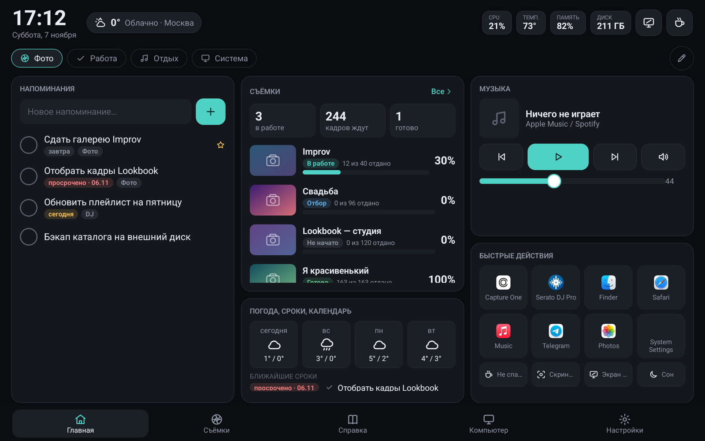 | 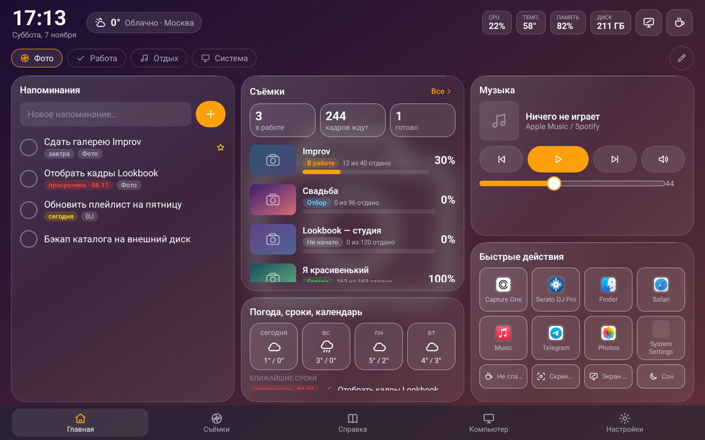 |
| *Приложение TabDock на планшете (демо-данные)* | *Свой скин: стекло, оранжевый акцент, размытая обложка съёмки* |

---

## Русский

**TabDock превращает планшет (или телефон), который лежит без дела, в док для работы на компьютере.**
Это не только для фотографов: при первом запуске вы выбираете сценарии — **Фото**, **Работа**, **Отдых**,
**Система и сеть** — и для каждого получаете своё пространство с виджетами, которые можно переставлять и менять.
Фотографам — больше всего: прогресс обработки съёмок в Capture One (и по папкам для Photon Studio, Photoshop),
отбор, сроки сдачи, галереи клиентов в wfolio, диски и бэкапы каталога.

Всё работает локально в домашней сети: без облака, аккаунтов и подписок (интернет нужен только для погоды
и проверки ссылок wfolio). Сервер — компьютер с macOS 13+ или **Linux** (Ubuntu, Debian, Fedora, Arch), клиент — Android-приложение TabDock
или любой современный браузер на планшете, телефоне или самом компьютере.

### Передача файлов между телефоном и компьютером — как AirDrop, только для всех

Перешли с iPhone на Android, а компьютер — Mac или Linux? Тогда вы знаете, чего не хватает больше всего: просто
перекинуть фото, документ или ссылку между телефоном и компьютером. Без проводов, мессенджера «самому себе»,
облака и почты. TabDock делает это в домашней сети, в обе стороны и между любыми системами:

* **С телефона на компьютер** — «Поделиться → TabDock» в любом приложении (Фото, Файлы, браузер, мессенджер).
  Фото, видео и любые файлы попадают на компьютер в «Загрузки → TabDock», ссылка открывается в браузере
  компьютера, текст — в его буфер обмена.
* **С компьютера на телефон** — окно «Передача файлов» (значок TabDock в строке меню / трее → «Передача
  файлов…»): перетащите туда любые файлы, выберите устройство или «всем». Телефон заберёт их сам, сохранит в
  «Загрузки → TabDock» и покажет уведомление — нажмите, чтобы открыть.
* **Кнопка «Файлы» в нижней панели приложения** — история всего, что передано в обе стороны: нажмите на файл —
  он откроется, значок папки — откроется «Загрузки → TabDock» в системных «Файлах». Оттуда же кнопка «Отправить на
  компьютер» — выбрать любые файлы на телефоне. Кнопку, как и остальные внизу, можно убрать в настройках.
* **Любые файлы и любой размер**: фото, видео, PDF, архивы, программы — проверено с файлами по 300 МБ, файлы
  приходят без изменений (контрольные суммы совпадают). Скорость — как у вашей домашней сети.
* **Mac ↔ Android и Linux ↔ Android** одинаково. Файлы идут напрямую между устройствами в вашей сети — без
  облака и посредников, никуда не загружаются.

### Поддержать разработчика

TabDock делает один человек в свободное время. Он бесплатный, с открытым кодом, без рекламы, подписок и сбора
данных — и таким останется. Поддержка нужна, чтобы проект развивался быстрее и не заглох:

* **Время.** Каждая версия — это вечера разработки и проверки на настоящих устройствах. Поддержка позволяет
  тратить на TabDock больше времени: чаще выпускать обновления и быстрее чинить ошибки.
* **Магазины и новые платформы.** Публикация в RuStore и Google Play, а для приложения на iPhone/iPad — платный
  аккаунт разработчика Apple. Без этого приложение ставится только из APK.
* **Открытость.** Всё, что сделано, остаётся в открытом коде, бесплатно для всех — в том числе для тех, кто
  поддержать не может.

Переведите любую сумму через ЮMoney — наведите камеру на QR-код или откройте ссылку, сумму вы выбираете сами:

[](https://yoomoney.ru/to/4100115736818477)

**[yoomoney.ru/to/4100115736818477](https://yoomoney.ru/to/4100115736818477)** — спасибо! Помочь можно и бесплатно:
поставить звёздочку репозиторию, рассказать о TabDock знакомым, написать об ошибке или идее в
[Issues](https://github.com/jjustping/tabdock/issues).

### Пространства и виджеты (v0.7)

| | |
|---|---|
| 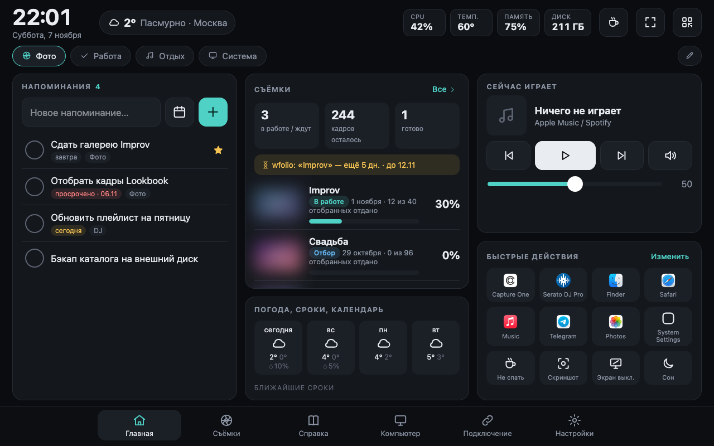 | 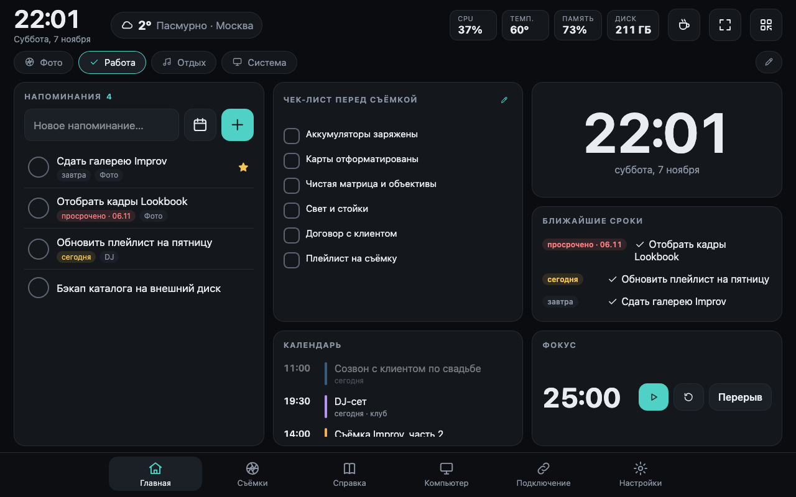 |
| *Фото: напоминания, съёмки, музыка, быстрые действия, сроки* | *Работа: задачи, заметка-чек-лист, часы, сроки, календарь, фокус-таймер* |
| 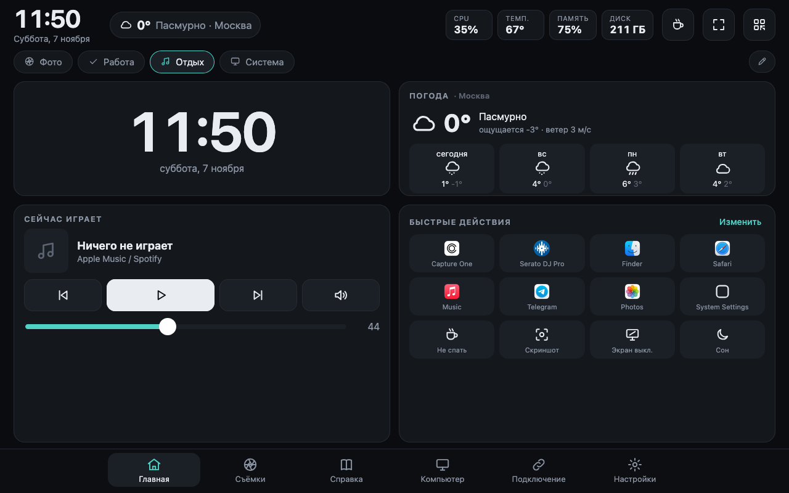 | 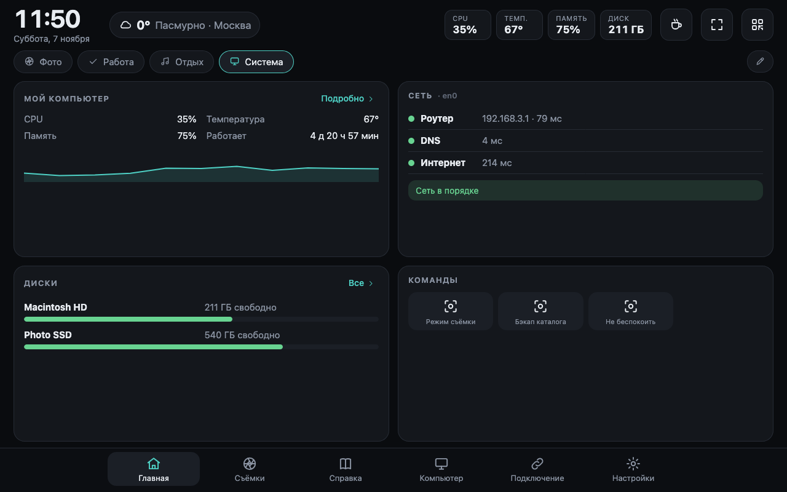 |
| *Отдых: часы, погода, плеер, быстрые действия* | *Система: нагрузка и температура, сеть (роутер, DNS, интернет), диски, кнопки Apple Shortcuts* |

* Пространства переключаются вкладками над виджетами или **свайпом**. Кнопка карандаша — **режим редактирования**:
  переставить виджет, изменить ширину/высоту (сетка 12×6), удалить, «+ Виджет» из каталога, переименовать
  пространство, сменить значок, добавить новое из шаблона.
* **16 виджетов**: напоминания, съёмки, погода+сроки+календарь, музыка, быстрые действия, часы, погода, ближайшие
  сроки, календарь, компьютер, диски, заметка (с чек-листами), фокус-таймер, **сеть**, **команды Apple Shortcuts**,
  галереи wfolio.
* Виджет перерисовывается, только когда изменились его данные (быстрее на планшете), стекло на сенсорных экранах
  размывается легче.

### Первая настройка (v0.7)

| | | |
|---|---|---|
| 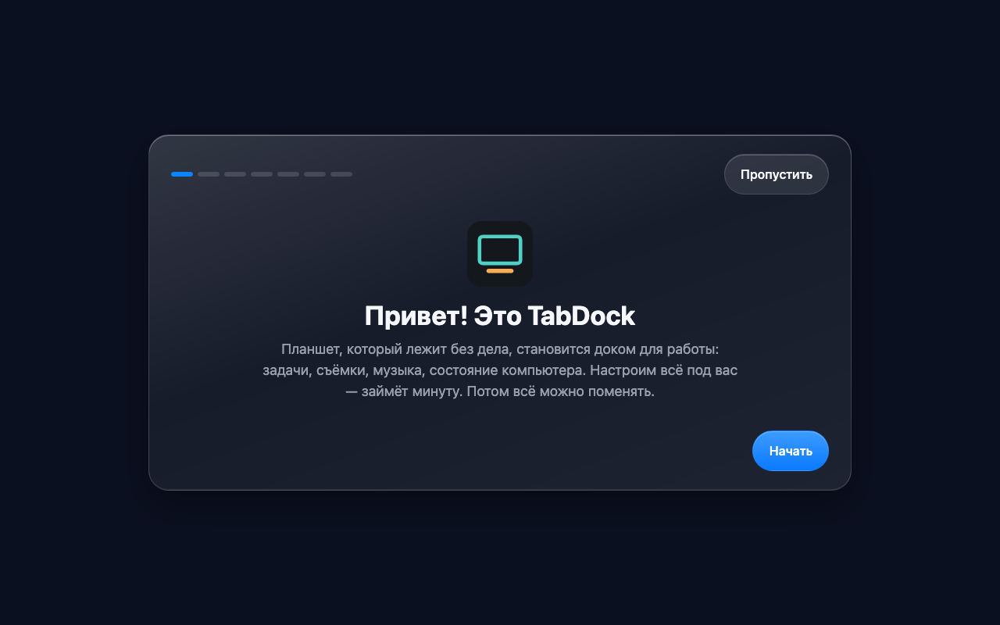 | 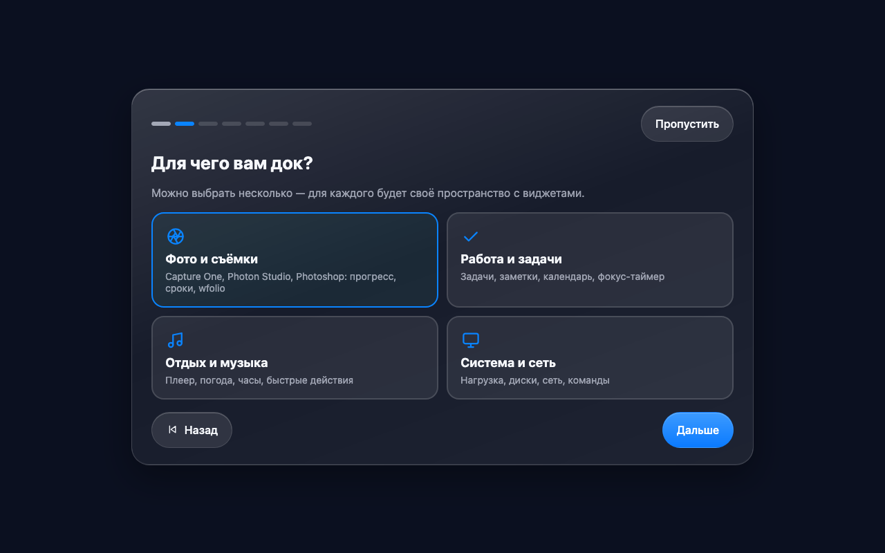 | 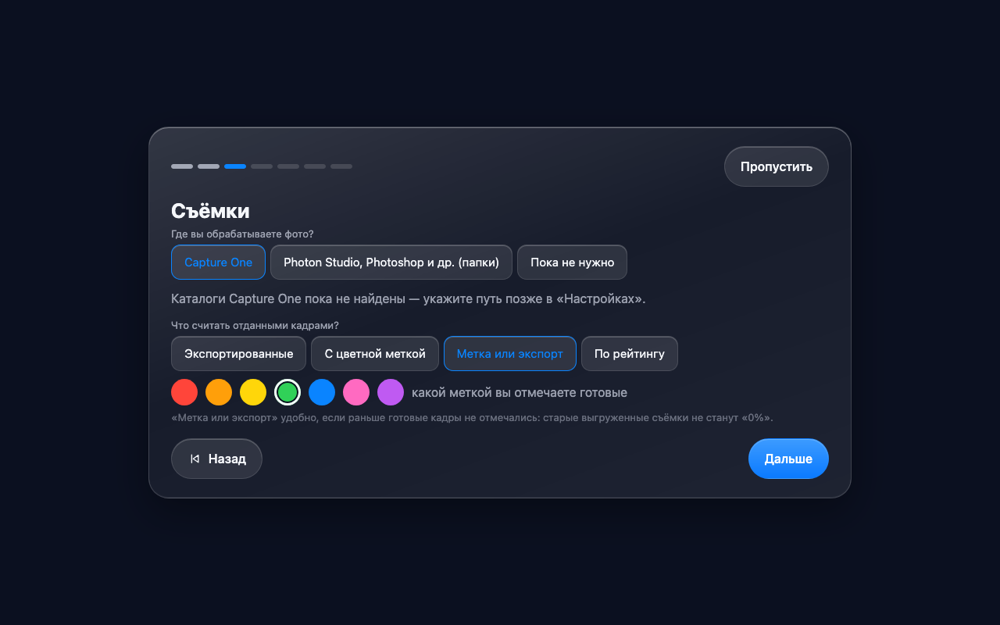 |

Сценарии → (для фото) где вы обрабатываете и **что считать отданным** → город для погоды → скин → подключение
планшета (QR, пароль). Пройти заново: «Настройки → Пройти первую настройку заново».

### Что ещё умеет

| Блок | Что делает |
|---|---|
| **Напоминания** | Свой список: добавить одной строкой, отметить касанием, срок (сегодня / завтра / дата), ★ важное, теги. Выполненные прячутся. |
| **Съёмки · Capture One** | Читает каталог(и) Capture One **только для чтения**. Каждая съёмка — это альбом: обложка, сколько кадров, сколько отобрано (★ или цветная метка), сколько экспортировано (по истории процессинга), прогресс и статус. Статус, цель (сколько кадров сдать), срок, клиента и заметку можно задать вручную. Можно добавить съёмку вручную, если её нет в каталоге. Кнопка «Открыть в Capture One». |
| **Справка** | Карточки-шпаргалки с простым форматированием (`- список`, `**жирный**`, `` `код` ``), ссылками, цветом, разделами и закреплением. Редактируются с планшета. |
| **Mac** | Загрузка CPU с графиком, температура SoC и SSD (без sudo), память и swap, все диски (внешние можно извлечь), аптайм, IP. |
| **Музыка** | Apple Music / Spotify: что играет, обложка, пауза / назад / вперёд, громкость и mute. |
| **Быстрые действия** | Запуск выбранных приложений (иконки берутся из самих приложений), «Не спать» (caffeinate), скриншот на Рабочий стол, выключить экран, сон (двойное касание для подтверждения), открыть папки. |
| **Погода и календарь** | Погода Open-Meteo (бесплатно, без ключа) на 4 дня; события Календаря macOS на сегодня и завтра. |
| **Подключение** (v0.2) | Отдельная вкладка: вход по QR **или по паролю**, планшет сам ищет TabDock в домашней сети и показывает список, автопереключение, если текущий Mac пропал. |
| **Скины** (v0.6) | Классика, Liquid Glass, Aero · Vista, Aero · Seven, Mac OS X, Бумага, OLED — выбираются в «Настройках» на каждом устройстве, можно задать скин по умолчанию для всех. Иконки нарисованы, без эмодзи. |
| **Каталоги где угодно** (v0.6) | Каталоги ищутся в настройках Capture One (текущий и недавние), Spotlight, «Изображениях» и в корне внешних дисков. По умолчанию — открытый в Capture One; в «Настройках» можно выбрать любые или вписать свой путь. |
| **Съёмки по папкам** (v0.5) | Для редакторов без каталога — Photon Studio, Photoshop и др.: подпапка = съёмка, исходники (RAW) против готовых файлов в подпапке экспорта, рабочие `.photon`/`.psd`, обложка. Настраивается в «Настройках». |
| **«Экспорт закончился»** (v0.5) | Когда Capture One или экспорт в папку перестаёт добавлять файлы, на планшете появляется баннер со звуком: «Свадьба: +24 кадра, 60 из 96». |
| **Ближайшие сроки** (v0.5) | Сдача съёмок, истечение галерей wfolio и напоминания со сроком на 14 дней вперёд — в одном списке на главной. |
| **Чек-листы** (v0.5) | В справке строки `- [ ] пункт` отмечаются касанием; «Снять все отметки» перед следующей съёмкой. |
| **Диски и бэкапы** (v0.5) | Внешние диски: модель, USB/Thunderbolt, файловая система, SMART, свободное место; отметка диска с каталогом и предупреждения «диск с каталогом не подключён», «мало места», «бэкап каталога N дней назад». |
| **Галереи wfolio** (v0.2) | Ссылки на клиентские галереи со сроком хранения: сколько дней осталось, предупреждение за 14 дней, раз в 6 часов док проверяет, открывается ли ссылка. Привязка к съёмке Capture One. |

### Как это работает


*Планшет и Mac в домашней сети; в интернет уходят только погода и проверка ссылок wfolio.*

### Экраны


*Главная: напоминания, съёмки Capture One с прогрессом, погода и календарь, музыка, быстрые действия.*


*Справка: свои шпаргалки и ссылки, разделы, цвета, закрепление.*


*Mac: процессор, температура, память, диски (внешние можно извлечь), системные действия и приложения.*


*Настройки: город для погоды, календарь, приложения в быстрых действиях, каталоги Capture One.*

(Все экраны сняты в демо-режиме: съёмки и обложки выдуманные.)

### Темы оформления (скины)

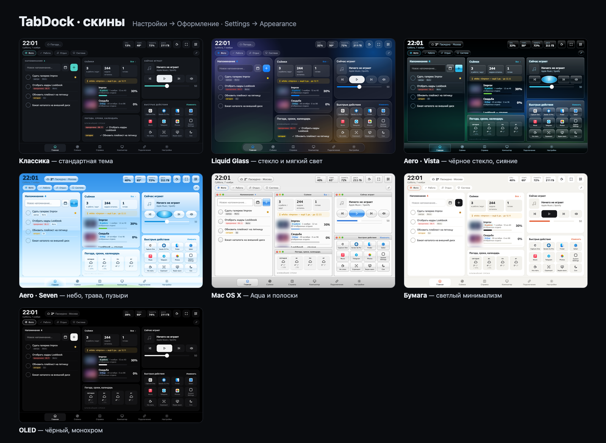

Скин выбирается в **«Настройки → Оформление»** и запоминается на каждом устройстве отдельно: на планшете может быть
Aero, а на Mac — «Бумага». Кнопка «Сделать скином по умолчанию для всех» задаёт скин для новых устройств. Для
просмотра без переключения можно открыть адрес с `?skin=glass` (или `aero-vista`, `aero-seven`, `macosx`, `paper`, `oled`).
Во всех скинах — нарисованные иконки, без эмодзи.

| Скин | Настроение |
|---|---|
| **Классика** | стандартная тема: тёмная и спокойная |
| **Liquid Glass** | полупрозрачное стекло с бликом по краю, мягкий цветной свет, плавающая «капсула» вкладок |
| **Aero · Vista** | Frutiger Aero в духе Windows Vista: чёрное глянцевое стекло, «северное сияние», голубые глянцевые кнопки |
| **Aero · Seven** | Frutiger Aero в духе Windows 7: небо, зелёный холм, пузыри, белое глянцевое стекло, «травяные» индикаторы |
| **Mac OS X** | Aqua 2000-х: полосатый фон, Lucida Grande, глянцевые синие кнопки, каждая карточка — окно со «светофором» |
| **Бумага** | светлый минимализм на каждый день, тёплый белый, чёрные кнопки, один акцент |
| **OLED** | чистый чёрный и монохром — для ночи и OLED-экранов |

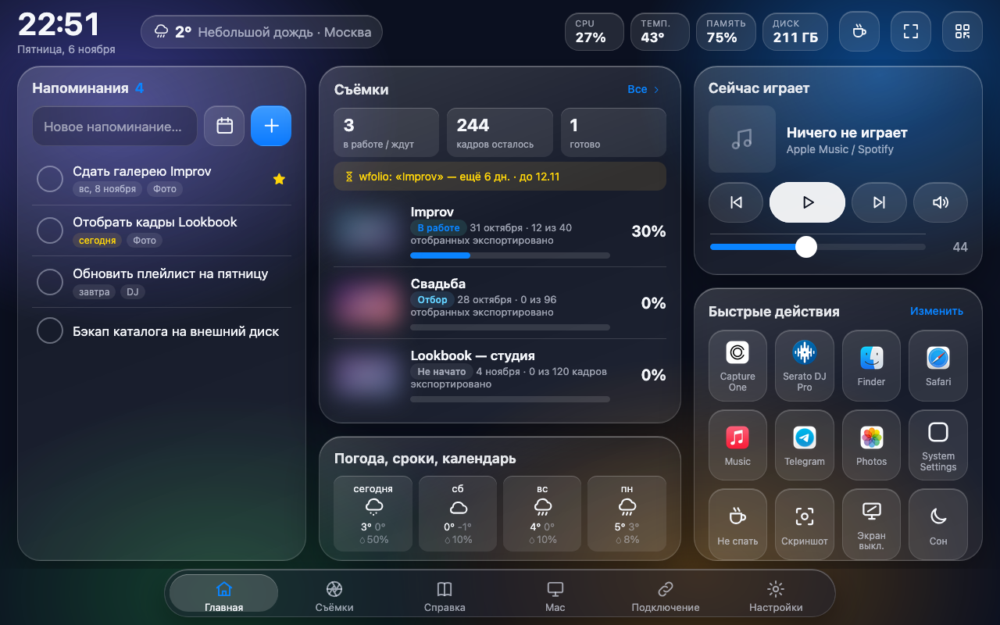
*Liquid Glass*

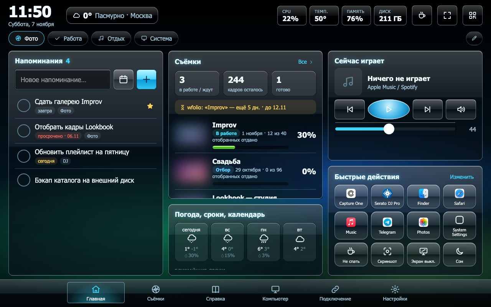
*Aero · Vista*

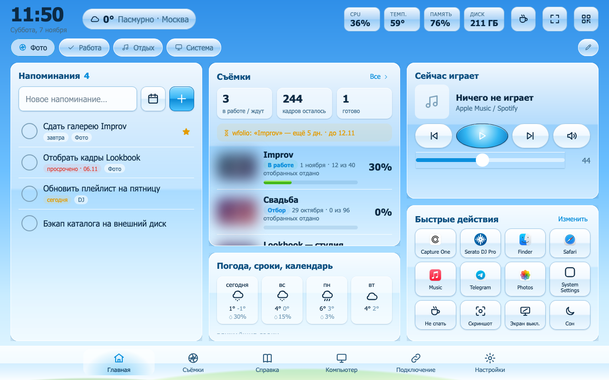
*Aero · Seven*

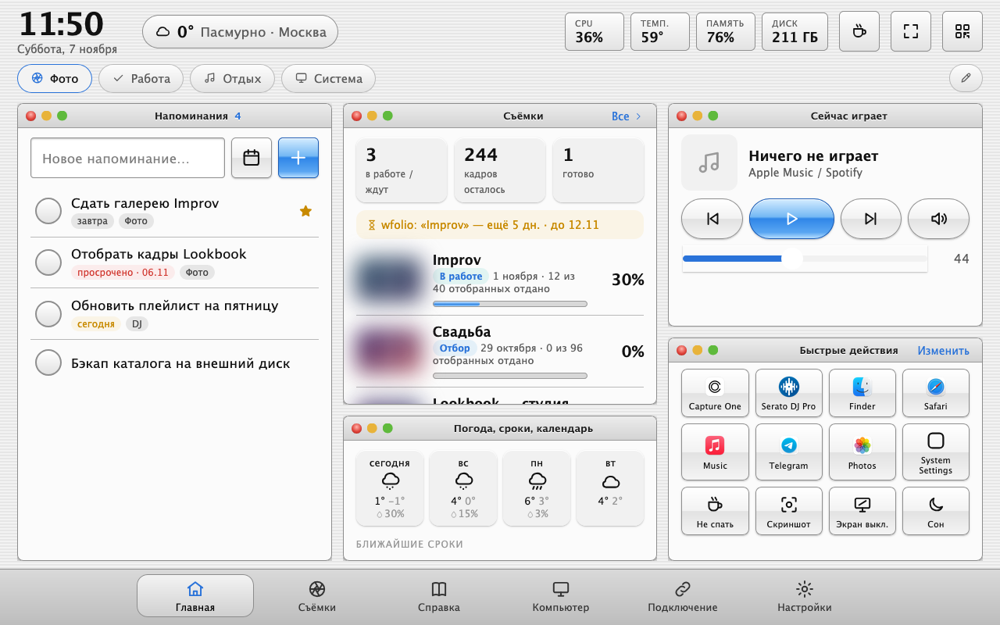
*Mac OS X*

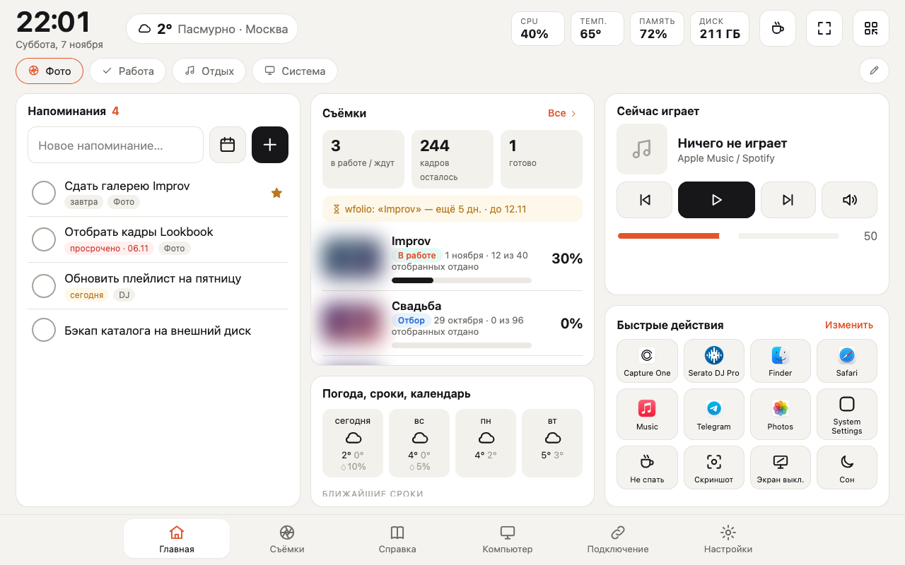
*Бумага*

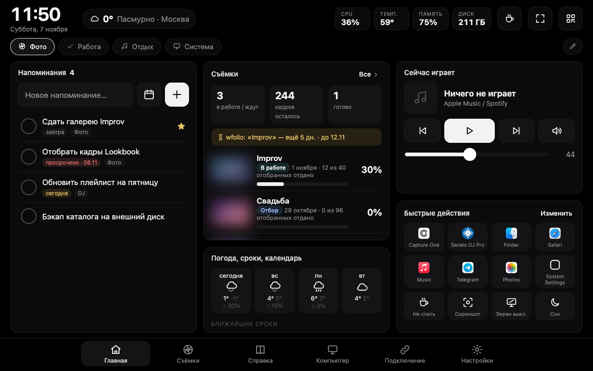
*OLED*

Свой скин — это один CSS-файл в `web/skins/`: он переопределяет переменные (`--bg`, `--card-bg`, `--accent`, `--r`, …)
и при желании добавляет детали. Добавьте его в список `SKINS` в `web/app.js`.

### Установка на компьютер (Mac)

```bash
git clone … ~/tabdock     # или скопируйте папку; не кладите её в Документы/Рабочий стол/Загрузки
cd ~/tabdock
./install.sh
```

`install.sh` создаёт `.venv`, ставит единственную зависимость (`qrcode`), собирает помощник календаря
(`bin/dock-calendar`, нужен `swiftc` из Command Line Tools), регистрирует LaunchAgent
`~/Library/LaunchAgents/com.jjustping.tabdock.plist` (старт при входе в macOS, перезапуск при падении)
и открывает панель в браузере.

```bash
./install.sh --status      # запущен ли и ссылка для планшета
./install.sh --port 9000   # другой порт
./install.sh --uninstall   # убрать автозапуск (данные в data/ остаются)
```

Ручной запуск без автозапуска: `.venv/bin/python server.py` → http://localhost:8787

**Панель управления.** Если открыть `http://localhost:8787` на самом компьютере, там не копия дока, а панель:
QR-код для подключения, подключённые сейчас устройства, обновления (со списком изменений и кнопкой «Обновить
сервер», если он стоит из `git clone`), пароль для входа и новый ключ доступа. Полный док в браузере остаётся по
ссылке внизу панели — например, для iPhone/iPad.

**Значок в строке меню.** TabDock живёт в строке меню Mac (значок планшета): видно, работает ли служба, адрес для
подключения (клик — скопировать), **какие устройства подключены сейчас**, галочка **«Запускать при входе»**,
QR-код для нового устройства, «Открыть TabDock», «Перезапустить службу», журнал и «Остановить». Если сервер не
отвечает, значок меняется на предупреждение. После обновления `TabDock.app` macOS может один раз заново спросить
доступ к диску / календарю / автоматизации.

### Установка на компьютер (Linux)

Ubuntu/Debian, Fedora, Arch — с рабочим столом (GNOME, KDE, XFCE…). Проверено на **Ubuntu 26.04** (ARM64, Parallels).

```bash
git clone https://github.com/jjustping/tabdock.git ~/tabdock
cd ~/tabdock
./install-linux.sh
```

`install-linux.sh` ставит пакеты через `apt` / `dnf` / `pacman` (спросит пароль `sudo`): Python, Avahi (чтобы
приложение само нашло компьютер), `playerctl` (музыка из любого плеера: Spotify, браузер, VLC, Rhythmbox…),
WirePlumber (громкость), udisks2 (извлечение дисков), lm-sensors (температура), значок в трее. Дальше — venv,
**пользовательская служба systemd** `tabdock.service` (старт при входе, перезапуск при сбое, без root), значок в трее
`tabdock-tray.service`, при включённом `ufw` — порт 8787 только для домашних сетей, и в конце **QR-код прямо в
терминале**.

```bash
./install-linux.sh --status       # работает ли и адрес для планшета
./install-linux.sh --port 9000    # другой порт
./install-linux.sh --no-packages  # без apt/dnf/pacman, если всё уже стоит
./install-linux.sh --keys         # разрешить «Своим кнопкам» нажимать клавиши (Wayland; один раз перезайти)
./install-linux.sh --uninstall    # убрать службы (данные в data/ остаются)
journalctl --user -u tabdock -f   # журнал
```

Что работает на Linux так же, как на Mac: пространства и виджеты, напоминания, заметки и шпаргалки, погода,
состояние компьютера (процессор, память, диски, температура), музыка и громкость, быстрые действия (приложения из
меню, сон, выключение экрана, скриншот, «не спать», извлечение дисков), сеть, съёмки по папкам, wfolio, приложение
для Android. Отличия:
* **«Команды»** — вместо Apple Shortcuts ваши скрипты: положите исполняемый файл в `~/.config/tabdock/commands/`,
  и он появится кнопкой на планшете (бэкап, перезапуск контейнера, `git pull`…).
* **Календарь** — из файлов `.ics`: локальные календари GNOME/Evolution и любые `.ics` в `~/.config/tabdock/calendars/`.
* **Скриншот** под Wayland делается через системный портал: в первый раз рабочий стол спросит «Разрешить?».
* **Значок в трее** — то же меню, что в строке меню Mac (в GNOME нужен AppIndicator, в Ubuntu он включён).
* Capture One на Linux нет; съёмки — по папкам (darktable/digiKam — в планах).

### Приложение TabDock для Android (бета)

`client-android/` — **полностью нативное приложение** (Kotlin + Jetpack Compose), а не страница в оболочке:
все экраны, виджеты, скины, настройки, первая настройка и отбор кадров нарисованы нативно, с сервером оно
общается через тот же API. Работает на планшете (сетка 12×6, как в веб-версии) и на **телефоне** (одна колонка,
боком — две). Сам находит компьютер в сети (Bonjour + опрос сети), подключается только к компьютеру, который
подтвердил ключ, не даёт экрану гаснуть, переподключается сам.

| | | |
|---|---|---|
| 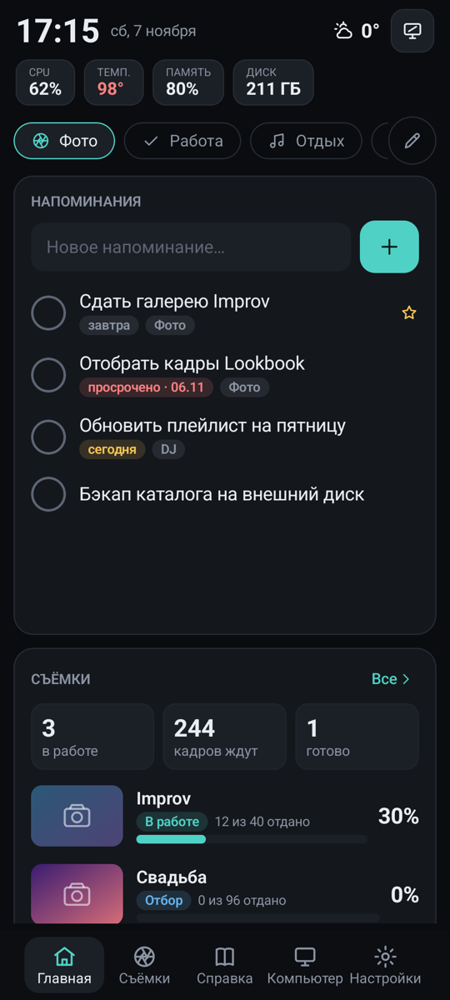 | 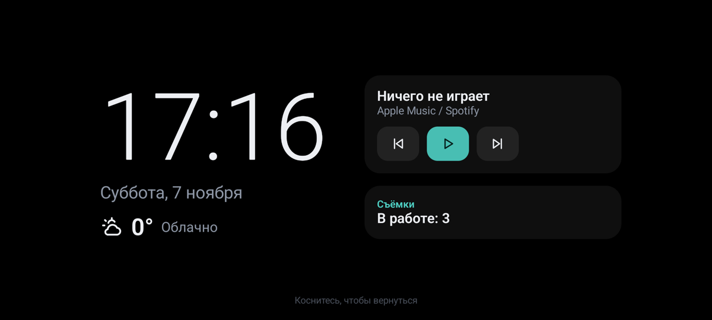 | 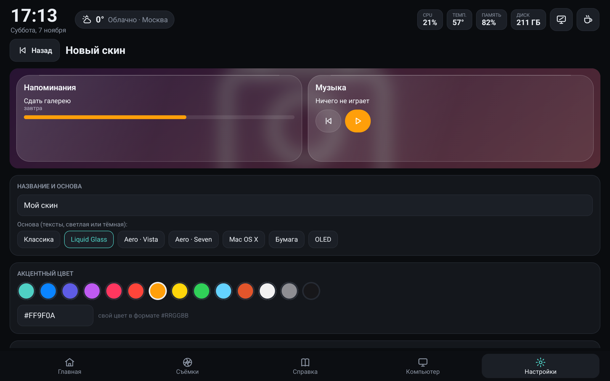 |
| *Телефон: одна колонка* | *Подставка: телефон боком на зарядке* | *Конструктор скинов с живым превью* |

* **Конструктор скинов** (Настройки → Оформление → «Свой скин»): основа из семи скинов, акцентный цвет (палитра или
  `#RRGGBB`), фон — цвет, градиент или **размытая обложка съёмки**, карточки (плоские, стекло, глянец, окна Mac OS X),
  скругление углов. Живое превью. Скин передаётся на другое устройство через буфер обмена («Скопировать» → «Вставить скин»).
* **Свои кнопки** (виджет «Свои кнопки», настройка — значок ⚙): как Stream Deck на планшете. Кнопка нажимает
  сочетание клавиш (`cmd+shift+4`, `ctrl+alt+t`, `f5`…), вставляет готовый текст, открывает сайт, папку или
  приложение, запускает команду (Apple Shortcut на Mac, свой скрипт из `~/.config/tabdock/commands` на Linux).
  Кнопки общие для всех устройств компьютера. Произвольные команды оболочки нельзя — только то, что вы сами положили
  в папку команд. Для сочетаний клавиш на Mac один раз нужен «Универсальный доступ» для TabDock, на Linux под
  Wayland — `./install-linux.sh --keys`.
* **Передача файлов** в обе стороны — см. раздел «Передача файлов между телефоном и компьютером» выше.
* **Шпаргалки** («Справка» → «Шпаргалки»): готовые наборы — горячие клавиши macOS, Ubuntu/GNOME и терминала,
  Photoshop, Capture One, Lightroom Classic, команды для сисадминов (сеть, службы, логи, диски, ssh/rsync/tmux),
  git и VS Code для программистов и «рофлы для терминала» (`sl`, `cowsay`, `cmatrix`, попугай `curl parrot.live`…).
  Первая настройка сама добавляет наборы под выбранные сценарии; их можно править и удалять как обычные заметки.
* **Подставка**: спокойный экран — большие часы, погода, что играет (с кнопками), ближайший срок сдачи. На телефоне
  включается сама, когда он лежит боком на зарядке (можно выключить), на любом устройстве — кнопкой со значком
  экрана в шапке. Содержимое слегка смещается раз в минуту, чтобы не выгорал OLED.
* **Без связи с компьютером** приложение показывает последние полученные данные и обложки (с пометкой «данные от
  ЧЧ:ММ») и подключается само, когда компьютер вернётся.
* **Уведомления**: «экспорт закончился» и «сегодня / завтра сдать съёмку» (раз в день на съёмку). Работают, пока
  приложение открыто или свёрнуто; если его закрыть совсем — не проверяется ничего. Выключаются в настройках.
* **VPN.** Если VPN включён **на компьютере**, сервер отвечает устройствам из домашней сети напрямую через Wi-Fi/Ethernet
  (отдельный сокет, привязанный к сетевой карте), мимо туннеля. Если VPN включён **на телефоне или планшете**, приложение
  ходит к компьютеру через Wi-Fi напрямую, если VPN это разрешает. Если не разрешает — **в настройках VPN-клиента
  добавьте TabDock в исключения**. Приложение само показывает эту подсказку и до тех пор показывает последние
  сохранённые данные.
* На Android 17 приложение один раз просит разрешение «Устройства в локальной сети», на Android 13+ — уведомления.
* **Подключение по QR-коду** — кнопкой «Сканировать QR-код» в самом приложении (на экране подключения и в
  Настройках). Камера телефона для этого не подходит: она открывает ссылку в браузере.
* **Обновления**: когда выходит новая версия, приложение показывает, что изменилось, и по кнопке «Обновить»
  скачивает и ставит её (Android один раз спросит разрешение устанавливать приложения). Проверяет компьютер,
  телефону интернет для этого не нужен.
* **Нижняя панель** настраивается: Настройки → «Нижняя панель» (например, убрать «Съёмки»).
* Заблокированному телефону приложение не мешает засыпать: в фоне оно не держит процессор и не ставит будильников
  (проверено на Pixel 8 в режиме глубокого сна).

```bash
cd client-android && JAVA_HOME=/opt/homebrew/opt/openjdk@17 ./gradlew assembleRelease
adb install -r app/build/outputs/apk/release/app-release.apk
```

Подписывается тем же ключом, что и старое приложение, поэтому ставится поверх него. Привязать к компьютеру:
открыть ссылку из QR на устройстве или `adb shell am start -d "<ссылка из QR>" com.jjustping.tabdock`.

#### Старое приложение (WebView, `android-webview/`)

Предыдущая версия — оболочка вокруг веб-интерфейса. Оставлена для истории, её заменяет нативное приложение из `client-android/`.
`android-webview/` — маленькое приложение (28 КБ) с WebView, которое
* **само находит Mac** через Bonjour (`_tabdock._tcp`) и опросом сети — браузер так не умеет;
* открывается на весь экран, **не даёт экрану гаснуть**, держит альбомную ориентацию;
* помнит последний Mac и вход; если Mac выключили или перезагрузили — показывает «Жду …» и **сам
  открывает панель**, как только Mac снова в сети; если пропал совсем — переходит на другой найденный TabDock;
* ссылки наружу (галереи wfolio и т.п.) открывает в обычном браузере.

Готовый APK старого приложения — в [релизе v0.6.1](https://github.com/jjustping/tabdock/releases/tag/v0.6.1) (актуальное приложение — [последний релиз](https://github.com/jjustping/tabdock/releases/latest)): скачайте на планшет, откройте,
разрешите установку из этого источника и нажмите «Установить».

Сборка без Android Studio и Gradle (нужны Android SDK и JDK 17, `brew install openjdk@17`):

```bash
./android-webview/build.sh               # → android-webview/build/TabDock.apk
adb install -r android-webview/build/TabDock.apk
```

Ключ подписи создаётся при первой сборке в `~/.android/tabdock-release.keystore` — сохраните его, иначе
обновить приложение поверх не получится (только удалить и поставить заново). Первый вход в приложении —
паролем, или передать ключ из QR: `adb shell am start -n com.jjustping.tabdock/.MainActivity -d "<ссылка из QR>"`.

### Подключение планшета


*Вход на планшете: пароль слева, справа TabDock, найденные в сети автоматически.*


*Вкладка «Подключение»: QR-код, пароль, ключ доступа, список Mac в сети и автоподключение.*

1. Устройство и компьютер в одной сети.
2. На компьютере откройте панель TabDock (значок в строке меню или трее) — там QR-код.
3. В приложении нажмите «Сканировать QR-код». Без приложения: отсканируйте камерой и откройте ссылку в браузере, он один раз предупредит о сертификате.
4. **Нажмите «Разрешить» в панели на компьютере** — устройство подключится само.

**Без QR — по паролю и поиску (v0.2).** На Mac: вкладка «Подключение» → «Пароль для входа» (или
`.venv/bin/python server.py --set-password`). На планшете откройте адрес Mac (например `https://192.168.1.50:8787`):
появится страница входа — пароль слева, справа список TabDock, которые планшет нашёл в сети сам
(опрашивает `/api/hello` на всех адресах вида 192.168.x.1–254, ~15 с). Нажмите на нужный — перейдёте к нему.

* Пароль хранится только как хэш PBKDF2; менять его можно только с самого Mac; 5 неверных попыток → пауза 5 минут.
* Сервер объявляет себя по Bonjour как `_tabdock._tcp` (браузер Bonjour не видит, поэтому планшет ищет опросом).
* «Автоподключение»: если текущий Mac пропал из сети больше чем на 15 с, планшет сам переходит на другой
  найденный TabDock.
* Ограничение браузера: самый первый адрес нужно открыть хотя бы раз (QR или вручную) — веб-страница не может
  искать в сети, пока она не открыта. Закрепите за Mac mini постоянный IP в роутере, чтобы ярлык не ломался.

Чужие устройства в сети видят только страницу входа. Отключить одно устройство можно в панели на компьютере, кнопка
«Новый QR-код» отключает все сразу. С самого компьютера (localhost) вход не нужен.

### wfolio


*Галереи wfolio: сколько дней хранения осталось, открывается ли ссылка, к какой съёмке привязана.*

У wfolio **нет открытого API**, вебхуков или выгрузки со сроками хранения (проверено по документации
docs.wfolio.pro 6 ноября 2026; CSV-выгрузка проекта содержит только избранное, без дат). Поэтому:

* галерея добавляется вручную: ссылка, срок хранения (как в настройках проекта wfolio), клиент, съёмка;
* док сам раз в 6 часов открывает ссылку: ● открывается / ● «Срок действия ссылки истёк» (или 404) / ● нет ответа;
* за 14 дней до конца срока на главной появляется предупреждение;
* логин и пароль wfolio **не нужны и не хранятся**.

Автоматически подтягивать список галерей можно было бы, только «притворяясь браузером» в личном кабинете
wfolio с вашей сессией — это хрупко и не одобрено wfolio, поэтому не сделано.

### Безопасность

**От чего TabDock защищает.** Кнопки, вставка текста и передача файлов делают доступ к TabDock почти равным доступу к
клавиатуре компьютера, поэтому защита рассчитана на эти случаи:

| Кто и что | Что происходит |
|---|---|
| Гость или чужое устройство в вашей Wi-Fi-сети | Без разрешения на самом компьютере видит только страницу входа. Подбор пароля и кода ограничен: 5 ошибок с адреса, 20 всего, затем пауза 5 минут |
| Кто-то подслушивает домашнюю сеть | Всё между устройством и компьютером идёт по **HTTPS**: пароль, данные и файлы зашифрованы |
| Компьютер в чужой сети выдаёт себя за ваш | Приложение помнит сертификат вашего компьютера (QR-код передаёт его отпечаток) и не подключается к другому |
| Устройство потеряли или продали | В панели на компьютере нажмите «Удалить» — **у каждого устройства свой ключ**, остальные продолжат работать |
| Сайт в браузере пытается управлять TabDock | Запросы с чужих сайтов отклоняются, подмена имени хоста тоже (защита от CSRF и DNS rebinding) |
| Запросы из интернета, если кто-то пробросит порт | Сервер отвечает только домашним сетям |

**Как подключается новое устройство.** QR-код или пароль дают право только *попросить* доступ: устройство начинает
работать, когда вы нажмёте «Разрешить» в панели на компьютере. Ключи хранятся на компьютере только в виде хэша, пароль — как
хэш PBKDF2. Менять пароль, разрешать и удалять устройства, отправлять файлы на телефон можно только с самого компьютера.

**Что TabDock не защищает.**
* Разрешённое устройство управляет компьютером: нажимает ваши кнопки, отправляет файлы, вставляет текст. Разрешайте только свои устройства.
* Если кто-то получит доступ к самому компьютеру (его учётной записи), TabDock не помешает: на нём панель открывается без входа.
* Браузер не умеет запоминать сертификат, как приложение, и один раз предупредит о нём («подключение не защищено» — так выглядит любой домашний сертификат). Проверить, что это ваш компьютер, в браузере нельзя, поэтому **по возможности используйте приложение**.
* TabDock рассчитан на домашнюю сеть. Не открывайте его порт в интернет.

### Разрешения macOS (один раз)

Служба запускается через маленькое приложение **TabDock.app** (`bin/TabDock.app`, собирается `install.sh`), поэтому
в настройках конфиденциальности разрешения выдаются ему, а не безымянному Python. Если каталог Capture One лежит
на внешнем диске: Системные настройки → Конфиденциальность и безопасность → Полный доступ к диску → «+» →
`~/tabdock/bin/TabDock.app`. После пересборки TabDock.app разрешение может понадобиться выдать заново.


macOS спросит разрешения у `python3` при первом обращении — нажмите «Разрешить»:

| Что | Зачем | Где включить вручную |
|---|---|---|
| Папка «Изображения» | читать каталог Capture One в `~/Pictures` | Настройки → Конфиденциальность → Файлы и папки (или «Полный доступ к диску» для python3, если каталог на внешнем диске) |
| Календари | события на главной | Конфиденциальность → Календари (`dock-calendar` или python3) |
| Автоматизация → Music / Spotify / Calendar | плеер и (запасной путь) календарь | Конфиденциальность → Автоматизация |
| Запись экрана | кнопка «Скриншот» | Конфиденциальность → Запись экрана |

Если календарь не нужен — «Настройки → Календарь → Выключить».

### Как считается прогресс съёмок


*Съёмки: статус, прогресс экспорта, сколько кадров отобрано и выгружено, срок wfolio.*

* **Съёмка** = пользовательский альбом в каталоге (служебные «Недавние импорты» пропускаются).
  Если альбомов нет, съёмками считаются импорты.
* **Экспортировано** = кадры, у которых есть запись в истории процессинга (вывода) Capture One.
* **Цель** = отобранные кадры (рейтинг ★1+ или любая цветная метка); если отбора нет — все кадры.
  Можно задать вручную (например, «сдать 40»).
* **Статус** автоматически: *Не начато* → *Отбор* (есть отобранные, ничего не выгружено) →
  *В работе* → *Готово*. Вручную можно поставить любой, в том числе *Сдано*.
* Каталоги ищутся сами (Spotlight + `~/Pictures`). Свой список — поле `c1_catalogs` в `data/config.json`.
* Сами правки (экспозиция и т.п.) в базе Capture One 16 надёжно не отмечаются, поэтому «обработано»
  определяется по экспорту.
* **Отбор с планшета** (приложение TabDock → съёмка → «Отбор и метки»): сетка миниатюр с фильтрами (без оценки, ★1+, ★3+,
  не экспортированы, по цвету) и просмотр на весь экран со свайпом. Звёзды и цветные метки записываются
  **через AppleScript самого Capture One** — база каталога не трогается. Нужно, чтобы каталог был открыт в
  Capture One, и один раз разрешить «TabDock → Capture One» в окне «Автоматизация».
  Миниатюры — из кэша Capture One (с правками), большой просмотр — встроенный в RAW снимок камеры
  (для Fuji RAF мгновенно, остальное декодирует macOS).

### Данные и устройство

```
server.py            HTTP-сервер (stdlib), API и раздача web/
dock/sysinfo.py      CPU (mach host_statistics), память (vm_stat), диски (df), сеть
dock/temps.py        температуры Apple Silicon через IOHIDEventSystem (ctypes, без sudo)
dock/media.py        Music/Spotify и громкость через AppleScript
dock/captureone.py   чтение каталога .cocatalog (sqlite, mode=ro)
dock/calendar_mac.py календарь: bin/dock-calendar (EventKit) или AppleScript
dock/weather.py      Open-Meteo
web/                 интерфейс (HTML/CSS/JS без сборки)
data/                ваши данные: config.json, reminders.json, notes.json, shoots.json
```

Логи службы: `~/Library/Logs/TabDock/`.

**Демо-режим для скриншотов:** `.venv/bin/python server.py --demo --port 8788 --data /tmp/tabdock-demo` —
выдуманные съёмки с обложками-заглушками, календарь и «Mac mini»; настоящий каталог не читается.
Добавьте `?privacy=1` к адресу, чтобы размыть обложки и ключ в QR. Все картинки в `docs/img` сняты так.

### Что проверено, а что нет (v0.4, 6 ноября 2026)

v0.4, безопасность: доказательство ключа в `/api/hello` (ключ не утекает), отказ при чужом Host (421),
отказ cross-site POST и не-JSON POST (403), отбрасывание `javascript:`-ссылок. **На планшете:** обновление поверх
0.3 сохранило вход и запомнило Mac; подменный сервер на том же адресе с другим ключом показан
«⚠ не подтверждён» и не открылся сам; после возврата настоящего сервера панель открылась сама.
Не проверено: доступ из публичной сети (отказ по адресу клиента проверен только кодом), два настоящих Mac.


v0.3, Android-приложение — **на настоящем Honor Pad 9** (Android 14): установка через adb, приложение само нашло
MacBook в сети и открыло вход; вход по ключу; после перезапуска приложения вход сохраняется; без сервера —
экран «Жду …», после запуска сервера панель открылась сама. Веб-версия в Chrome на планшете тоже проверена
(полный экран по первому касанию). Не проверено: переход на другой Mac, работа после перезагрузки планшета.

v0.2 (подключение и wfolio), на MacBook Air M1: пароль (задать только с Mac, вход, неверный пароль, блокировка
после 5 попыток — HTTP 429), страница входа с LAN-адреса, поиск в сети (headless Firefox нашёл оба запущенных
сервера на :8787 и :8788 за 13 с), Bonjour-объявление (`dns-sd -B _tabdock._tcp`), галереи wfolio: добавление,
проверка ссылки (200 → «открывается», 404 → «истекла»), отбраковка неправильных ссылок.
Не проверено: автопереключение на другой Mac при реальном пропадании сервера, поиск с самого планшета,
настоящая ссылка wfolio (текст «Срок действия ссылки истёк» взят из документации wfolio).

v0.1:

Проверено на **MacBook Air M1** (macOS 15.7), запуск вручную:
* сервер, API (напоминания, заметки, съёмки, действия с проверкой допустимых значений), ключ доступа
  (без ключа — 401, по ссылке из QR — cookie);
* чтение реального каталога Capture One (3 альбома, обложки, экспорт 163/163);
* температуры, CPU, память, диски, громкость, погода; интерфейс в браузере 1280×800.

**Не проверено:**
* на самом Mac mini M4 и на планшете Honor Pad 9 (нужно сопряжение Wi-Fi-отладки);
* `install.sh` и LaunchAgent целиком (синтаксис и plist проверены, но установка не запускалась);
* доступ к Календарю: на MacBook доступа пока нет — нужен ответ на запрос macOS;
* обложка и управление при реально играющей Music/Spotify; Spotify не установлен;
* сеансы Capture One (`.cosessiondb`) — сейчас поддерживаются только каталоги.

### Что готово сейчас

Состояние на 7 ноября 2026. ✅ — работает и проверено на настоящих устройствах (Mac mini M4, Honor Pad 9, Pixel 8);
🧪 — сделано, но проверено не до конца; ⏳ — в планах.

| Часть | Статус |
|---|---|
| Сервер на macOS: автозапуск, поиск в сети (Bonjour), ключ + пароль, защита от чужих сетей | ✅ |
| **Сервер на Linux**: `install-linux.sh`, служба systemd, Avahi, показатели, музыка (MPRIS), громкость, быстрые действия, «Команды»-скрипты, календарь `.ics` | ✅ Ubuntu 26.04 (Parallels); Fedora/Arch — 🧪 по коду |
| **Значок в строке меню (Mac) и в трее (Linux)**: статус, подключённые устройства, автозапуск, перезапуск, журнал | 🧪 Mac: запущен на Mac mini, данные для меню (устройства, адрес) проверены; Linux: трей запущен на Ubuntu |
| **Шпаргалки** по сценариям (8 наборов) | ✅ |
| Пространства и 16 виджетов, режим редактирования, 7 скинов | ✅ |
| Съёмки Capture One: прогресс, статусы, сроки, правило «что считать отданным» (метка / экспорт / рейтинг), каталоги на внешних дисках | ✅ |
| Съёмки по папкам (Photon Studio, Photoshop и др.) | 🧪 на реальных съёмках ещё не проверено |
| Музыка, громкость, быстрые действия, Apple Shortcuts, погода, календарь, сеть, диски | ✅ |
| **Приложение TabDock для Android** (нативное): все экраны, настройки и первая настройка нативные | ✅ бета |
| Раскладка для **телефона** (в том числе боком) | ✅ (Pixel 8, эмулятор) |
| **Конструктор скинов** (цвета, фон из обложки, стекло/глянец, передача на другое устройство) | ✅ |
| **Подставка** (часы, погода, плеер, срок; сама — на зарядке боком) | ✅ |
| Офлайн-кэш данных и обложек, автопереподключение | ✅ |
| Уведомления: экспорт закончился, срок сдачи сегодня/завтра | ✅ срок проверен, экспорт — нет (нужен реальный экспорт) |
| Погода больше не задерживает ответы сервера (обновляется в фоне) | ✅ |
| **Отбор с планшета/телефона**: миниатюры, просмотр на весь экран, фильтры | ✅ |
| Запись ★ и цветных меток в Capture One (через его AppleScript) | 🧪 написано, запись ещё не подтверждена на живом каталоге |
| Android 17: разрешение «локальная сеть» | ✅ |
| VPN на компьютере: устройства дома подключаются напрямую, мимо туннеля | ✅ проверено (MacBook с VPN) |
| VPN на телефоне/планшете | ✅ если VPN разрешает обход; иначе — в настройках VPN-клиента добавьте TabDock в исключения (приложение подсказывает) |
| Старое WebView-приложение (`android-webview/`) | заменено нативным приложением |
| Мастер установки «что и откуда поставить», darktable/digiKam, публикация в магазинах, iPhone/iPad | ⏳ |

### Дорожная карта

Принцип: TabDock — удобный док для компьютера, а не приложение «умею всё, но плохо». Новое добавляется, только если
оно действительно полезно рядом с компьютером, и доводится до конца.

| Этап | Что будет |
|---|---|
| ~~0.7 beta~~ | ✅ пространства и виджеты, первая настройка, правило «отдано», виджеты «Сеть» и «Команды» |
| ~~0.8 beta~~ | ✅ нативное Android-приложение, ✅ отбор с метками, ✅ раскладка для телефона, ✅ бета-релиз с APK |
| ~~0.9 beta~~ | ✅ подставка, ✅ конструктор скинов, ✅ офлайн-кэш, ✅ уведомления, ✅ VPN |
| ~~0.10 beta~~ | ✅ **сервер на Linux** и `install-linux.sh`, ✅ значок в строке меню / трее (устройства, автозапуск), ✅ шпаргалки по сценариям |
| ~~0.11 beta~~ | ✅ **кнопка «Сканировать QR-код»** в приложении; ✅ **проверка обновлений** со списком изменений (приложение предлагает скачать и поставить новую версию, значок в меню и панель — обновить сервер); ✅ **настраиваемая нижняя панель**; ✅ на компьютере вместо копии дока — **панель управления**; ✅ проверено: приложение не мешает глубокому сну телефона; осталось: запись меток в Capture One и обход VPN на компьютере |
| **0.12** (сейчас) | ✅ **передача файлов** в обе стороны (телефон ↔ Mac / Linux, любые файлы, окно на компьютере и экран «Файлы» с историей в приложении); ✅ **свои кнопки, как у Stream Deck** (сочетание клавиш, сайт/папка/приложение, команда, вставить текст); ✅ доработаны установщики Mac и Linux, самообновление сервера проверено на Linux |
| **0.13** (в работе) · надёжность и безопасность | **автотесты и сборка на GitHub** (проверки на Ubuntu и macOS, APK собирается и подписывается автоматически); **новый ключ подписи** приложения (один раз переустановить); **HTTPS** с сертификатом, который приложение запоминает при подключении; **отдельный ключ на каждое устройство**: список, отзыв, подтверждение нового устройства на компьютере; описание модели угроз; список изменений `CHANGELOG.md`; **удобство**: настройка любого элемента по долгому нажатию, приближение фото при отборе |
| 0.14 · админам и программистам | **мониторинг хостов** (ping/HTTP с уведомлениями), **Wake-on-LAN**, **бэкапы** (Time Machine / rsync — когда был последний), **SMART дисков**; **Docker** (запуск, остановка, журнал), **GitHub Actions** (статус сборок), **git-репозитории** |
| 0.15 · творчество | **darktable / digiKam** на Linux; **OBS** (сцены, запись, звук) и **звуковая панель** для стримеров |
| 1.0 · стабильный релиз | **простая установка**: пошаговый мастер «что и откуда поставить» и готовые пакеты — `.dmg` для Mac, `.deb` для Ubuntu/Debian; политика конфиденциальности, демо-скриншоты; **публикация в RuStore** (и, возможно, Google Play) |
| после 1.0 | виджеты на экране Android, уведомления при закрытом приложении, несколько компьютеров в одном доке, Lightroom Classic, сеансы Capture One, обмен файлами с устройствами без TabDock (совместимость с LocalSend) |
| отложено / думаем | **доступ не из дома** (Telegram-бот только для чтения, Tailscale/ZeroTier, сервер-посредник); **режим «домашнего центра»** с Home Assistant — планшет в доке как панель умного дома |
| iPhone / iPad | пока — веб-версия в Safari (Поделиться → «На экран Домой»); нативное приложение — после 1.0, если будет спрос (подробнее ниже) |

Windows пока не планируется (оценка — [docs/WINDOWS.md](docs/WINDOWS.md)).

**iPhone и iPad.** Сейчас на них работает веб-версия: откройте адрес компьютера в Safari и добавьте на экран «Домой».
Нативное приложение возможно (Compose Multiplatform позволяет переиспользовать большую часть экранов), но требует
платного аккаунта Apple Developer, проверки App Store, отдельной работы с локальной сетью и Bonjour на iOS и
тестирования на реальных устройствах — поэтому оно отложено до стабильной 1.0.

## English

**TabDock turns an idle tablet (or phone) into a work dock for your computer** — for everyday work, study and
fun, built with photographers in mind. On first launch you pick usage scenarios (**Photo**, **Work**, **Fun**,
**System & network**); each becomes a space of widgets you can rearrange. Photographers get the most: Capture One
(and folder-based Photon Studio / Photoshop) editing progress, culling, deadlines, wfolio galleries, disks and catalog
backups. Local network only, no cloud. Server: macOS 13+ or **Linux** (Ubuntu, Debian, Fedora, Arch); client: the Android app or any browser.

### Support the developer

TabDock is built by one person in their spare time. It is free and open source, with no ads, subscriptions or data
collection — and it will stay that way. Support keeps the project moving:

* **Time.** Every release means evenings of development and testing on real devices. Support buys more time for
  TabDock: more frequent updates and faster fixes.
* **Stores and new platforms.** Publishing on RuStore and Google Play, and a paid Apple developer account for an
  iPhone/iPad app. Until then the app is installed from the APK only.
* **Openness.** Everything stays open source and free for everyone, including those who cannot chip in.

Send any amount via YooMoney — scan the QR code or open the link; you choose the amount:

[](https://yoomoney.ru/to/4100115736818477)

**[yoomoney.ru/to/4100115736818477](https://yoomoney.ru/to/4100115736818477)** — thank you! Free ways to help: star
the repository, tell a friend, report a bug or share an idea in [Issues](https://github.com/jjustping/tabdock/issues).

### File transfer between phone and computer — like AirDrop, for everyone

Moved from an iPhone to Android while your computer is a Mac or runs Linux? Then you know what is missing most:
just sending a photo, a document or a link between the phone and the computer. TabDock does it on your home
network, both ways, across systems:

* **Phone → computer**: «Share → TabDock» in any app. Photos, videos and any files land in Downloads/TabDock on
  the computer, a link opens in the computer's browser, text goes to its clipboard.
* **Computer → phone**: the «File transfer» window (TabDock menu-bar / tray icon → «Передача файлов…»): drop any
  files, pick a device or «all». The phone takes them by itself, saves them to Downloads/TabDock and shows a
  notification.
* **«Файлы» button in the app's bottom bar**: the history of transfers both ways — tap a file to open it, the folder
  icon opens Downloads/TabDock in the system Files app, «Send to computer» picks any files on the phone. It can be
  removed from the bottom bar like the other buttons.
* **Any file, any size** — tested with 300 MB files, checksums match. Mac ↔ Android and Linux ↔ Android alike,
  directly between your devices — no cloud, nothing is uploaded anywhere.

**Status: beta.** Server and native Android app **TabDock 0.12.0-beta** ([download](https://github.com/jjustping/tabdock/releases/latest)). Ready and tested on real devices:
spaces & 16 widgets, 7 skins, Capture One progress with a configurable "delivered" rule, native Android app
(tablet + phone layouts), culling from the tablet/phone (thumbnails, full-screen viewer, filters), **0.9**: in-app skin builder (accent, colour /
gradient / blurred shoot-cover background, glass/gloss cards, copy-paste between devices), "stand" mode (big clock,
weather, player, next deadline; turns on by itself on a phone lying sideways on a charger), offline cache with
auto-reconnect, notifications (export finished, shoot due today/tomorrow). Done but not fully verified: writing
stars/colour tags back through Capture One's AppleScript, folder-based shoots, VPN on the phone/tablet: if it does not allow local traffic, add TabDock to the exclusions in your VPN client's settings — the app says so.
**0.10**: Linux server with `install-linux.sh` (systemd user service, Avahi, MPRIS media, PipeWire volume, quick
actions, your own scripts as "Commands", `.ics` calendar), menu-bar icon on the Mac and tray icon on Linux (status,
connected devices, start at login, restart, log), ready-made cheat sheets per scenario (macOS, Ubuntu/terminal,
Photoshop, Capture One, Lightroom, sysadmin, git + VS Code, terminal fun).
**0.12**: file transfer both ways between the phone and the computer (see above) and Stream-Deck-like custom
buttons (key combos, paste text, open a site/folder/app, run a command).
Planned: setup guide for the computer, darktable/digiKam, store releases (RuStore) at 1.0; iPhone/iPad use the web
UI in Safari for now.


### Features

* **Reminders**: its own list. Quick add, tap to complete, due dates, ★ important, tags.
* **Shoots · Capture One**: reads Capture One catalogs **read-only**. Each user album is a shoot,
  with a cover, total / picked (★ or colour tag) / exported (from the process history), progress and
  status. You can set the status, target, deadline, client and a note by hand, add manual shoots, and
  open a shoot in Capture One.
* **Reference**: cheat-sheet cards with light markdown, links, colours, sections and pins. Editable
  from the tablet.
* **Mac**: CPU with a sparkline, SoC/SSD temperatures (no sudo), memory/swap, disks (eject external
  ones), uptime, IP.
* **Music**: Apple Music / Spotify now playing, artwork, transport controls, volume and mute.
* **Quick actions**: launch your apps, keep-awake (caffeinate), screenshot, display off, sleep
  (tap twice to confirm), open folders.
* **Weather & calendar**: Open-Meteo forecast (free, no key) and today's/tomorrow's macOS Calendar
  events.
* **Connect tab (v0.2)**: sign in with the QR code **or a password**. The login page finds TabDock servers on
  the LAN by itself (it probes `/api/hello` across the /24 subnet; the server also advertises Bonjour
  `_tabdock._tcp`) and can fail over to another server automatically.
* **v0.6**: skins (Classic, Liquid Glass, Aero Vista, Aero Seven, Mac OS X, Paper, OLED) with drawn icons instead of
  emoji; Capture One catalogs anywhere (Capture One prefs, Spotlight, ~/Pictures, external disk roots), chooser in Settings.
* **v0.5**: folder-based shoots for Photon Studio / Photoshop (RAW vs exported files), "export finished" banner with
  a chime, upcoming deadlines (shoots, wfolio expiry, reminders), tappable checklists in notes, external disk details
  (model, bus, file system, SMART) with catalog-disk and catalog-backup warnings.
* **wfolio galleries (v0.2)**: wfolio has no public API, so you add gallery links with their storage end date.
  The dock checks every link every 6 hours (active / expired) and warns 14 days ahead. No wfolio credentials are
  used.

### How it works


*Tablet and Mac on the home network; only the weather and wfolio link checks go to the internet.*

### Screens (demo data)


*Home: reminders, Capture One shoots with progress, weather & calendar, music, quick actions.*


*Shoots: status, export progress, picked/exported counts, wfolio expiry.*


*wfolio galleries: days of storage left, link alive or expired, linked shoot.*


*Reference: your own cheat sheets and links.*


*Mac: CPU, temperature, memory, disks, system actions and apps.*


*Settings: weather city, calendar, quick-action apps, Capture One catalogs.*

### Skins


Pick a skin in **Settings → Appearance**; it is remembered per device (Aero on the tablet, Paper on the Mac), and one
can be set as the default for new devices. Preview without switching: add `?skin=glass` (or `aero-vista`, `aero-seven`,
`macosx`, `paper`, `oled`) to the address. All skins use drawn line icons, no emoji.

* **Classic** — the standard theme: dark and calm.
* **Liquid Glass** — translucent glass with specular edges over soft colour, floating tab capsule.
* **Aero · Vista** / **Aero · Seven** — Frutiger Aero: black glossy glass with aurora; sky, grass, bubbles and glossy white glass.
* **Mac OS X** — 2000s Aqua: pinstripes, Lucida Grande, glossy blue buttons, every card is a window with traffic lights.
* **Paper** / **OLED** — everyday minimal, light and true-black.

A skin is one CSS file in `web/skins/` overriding theme variables; register it in `SKINS` in `web/app.js`.

### Install

```bash
cd ~/tabdock && ./install.sh        # venv + calendar helper + LaunchAgent, opens the dashboard
./install.sh --status | --uninstall | --port 9000
```

Keep the folder outside Desktop/Documents/Downloads: background agents can't read those.
To run it by hand: `.venv/bin/python server.py` → http://localhost:8787. The Mac gets a menu-bar icon.

**Linux** (Ubuntu/Debian/Fedora/Arch with a desktop):

```bash
git clone https://github.com/jjustping/tabdock.git ~/tabdock && cd ~/tabdock && ./install-linux.sh
./install-linux.sh --status | --uninstall | --port 9000 | --no-packages
```

Installs packages (asks for sudo), a venv, a systemd **user** service and a tray icon, opens port 8787 for home
networks if `ufw` is on, and prints a QR code in the terminal. "Commands" on Linux are your executable scripts in
`~/.config/tabdock/commands/`; the calendar reads `.ics` files (GNOME/Evolution or `~/.config/tabdock/calendars/`).

### Android app

The **TabDock Android app** (`client-android/`, beta) is a fully native Kotlin + Jetpack Compose client: every screen, widget, skin,
settings, first-run setup and culling are native; tablet and phone layouts; Bonjour + subnet discovery, key pinning,
Android 17 local-network permission, Wi-Fi-bound connections when a VPN is on. Build with
`cd client-android && ./gradlew assembleRelease` (JDK 17).

The old WebView shell lives in `android-webview/`: a tiny (28 KB) WebView app that finds the Mac by itself (Bonjour `_tabdock._tcp` + subnet probe),
runs fullscreen, keeps the screen on, remembers the last Mac and sign-in, reopens the dock by itself when the Mac
comes back, and fails over to another TabDock. Build without Gradle: `./android-webview/build.sh` (Android SDK + JDK 17),
then `adb install -r android-webview/build/TabDock.apk`. Its last APK: [v0.6.1](https://github.com/jjustping/tabdock/releases/tag/v0.6.1); the current app: [latest release](https://github.com/jjustping/tabdock/releases/latest). Keep `~/.android/tabdock-release.keystore` to be able to update.

### Pair the tablet


*Tablet login: password on the left, TabDock servers found on the LAN on the right.*


*Connect tab: QR code, password, access key, servers on the LAN, auto-connect.*

Open the TabDock panel on the computer, press «Сканировать QR-код» in the app, then press «Разрешить» in the panel.
Other devices only see the sign-in page. Remove one device in the panel; «Новый QR-код» disconnects all of them.

### Security

Buttons, pasted text and file transfer make access to TabDock close to access to the computer's keyboard, so:
**HTTPS** for everything between a device and the computer, with a self-signed certificate pinned by the app (the QR code
carries its fingerprint); **a separate key per device**, stored only as a hash, each revocable on its own; **a new device starts
working only after you press «Разрешить» in the panel on the computer** (the QR code or password only let it ask);
private networks only, cross-site and DNS-rebinding protection, rate-limited sign-in.

Not covered: an allowed device can do what the dock can do, so allow only your own; anyone with access to the computer's own
account needs no sign-in; a browser cannot pin the certificate and warns once, so prefer the app. Do not expose the port to the internet.

### Roadmap

~~0.9~~ stand mode, skin builder, offline cache, notifications · ~~0.10~~ ✅ Linux server + installer, ✅ menu-bar /
tray icon, ✅ cheat sheets · **0.11** in-app QR scanner, update check with changelog, customizable bottom bar, a control
panel instead of the dock in the computer's own browser, deep-sleep check · **0.12** Stream-Deck-like custom buttons,
file transfer both ways · **0.13** reliability & security: tests and CI builds, a new signing key, HTTPS with a pinned
certificate, per-device keys with revoke and confirmation on the computer, a threat model, CHANGELOG; long-press to customize any element, zoom in photo culling · **0.14** host monitoring, Wake-on-LAN, backups,
SMART, Docker, GitHub Actions, git repos · **0.15** darktable/digiKam, OBS + soundboard · **1.0** setup guide and packages (.dmg for Mac, .deb
for Ubuntu/Debian), store release (RuStore, maybe Google Play) · after 1.0: Android home-screen widgets, notifications with the
app closed, multiple computers, Lightroom Classic, Capture One sessions, LocalSend compatibility · on hold / thinking: access from outside the
home (read-only Telegram bot, Tailscale/ZeroTier, relay), a Home Assistant "home hub" mode.
Principle: a convenient dock for your computer, not an app that does everything badly.
Windows is not planned for now ([docs/WINDOWS.md](docs/WINDOWS.md)).

### macOS permissions

The first time, macOS asks to allow `python3` access to Pictures (for the Capture One catalog),
Calendars, Automation (Music/Spotify/Calendar) and Screen Recording (for the screenshot button).
Click Allow, or turn them on in System Settings → Privacy & Security.

### Tested / not tested (v0.3)

Tested on a MacBook Air M1 (macOS 15.7), started by hand: the server, the API, key auth, reading a
real Capture One catalog, sensors, volume, weather, and the UI at 1280×800.
On a real Honor Pad 9 (Android 14): the web UI in Chrome (fullscreen on first tap) and the Android app
(finds the Mac by itself, keeps the sign-in after restart, reopens the dock when the server comes back).
Also: password login, LAN scan, Bonjour advertising, wfolio link checks.
**Not tested yet**: the Mac mini itself, the full `install.sh`/LaunchAgent run, failover to another Mac,
a playing Music/Spotify track, and Capture One sessions (only catalogs are supported).

License: MIT.
